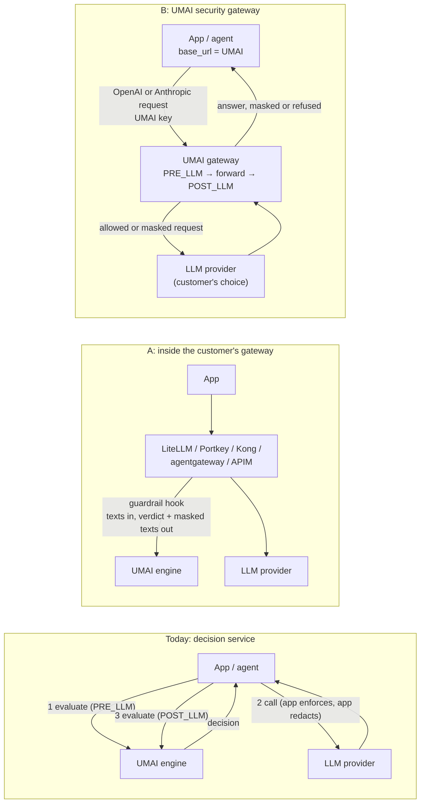
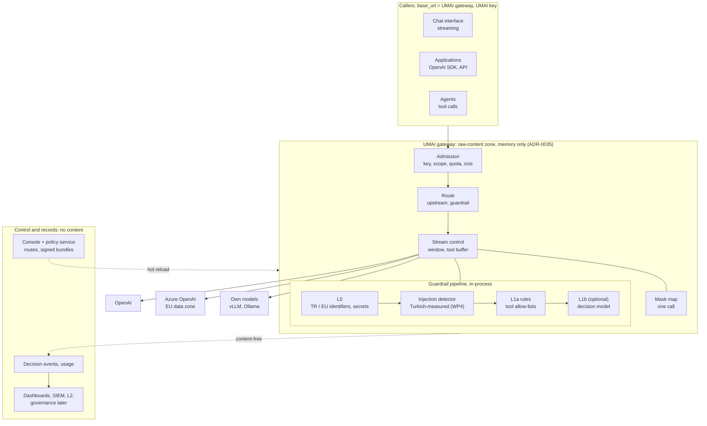
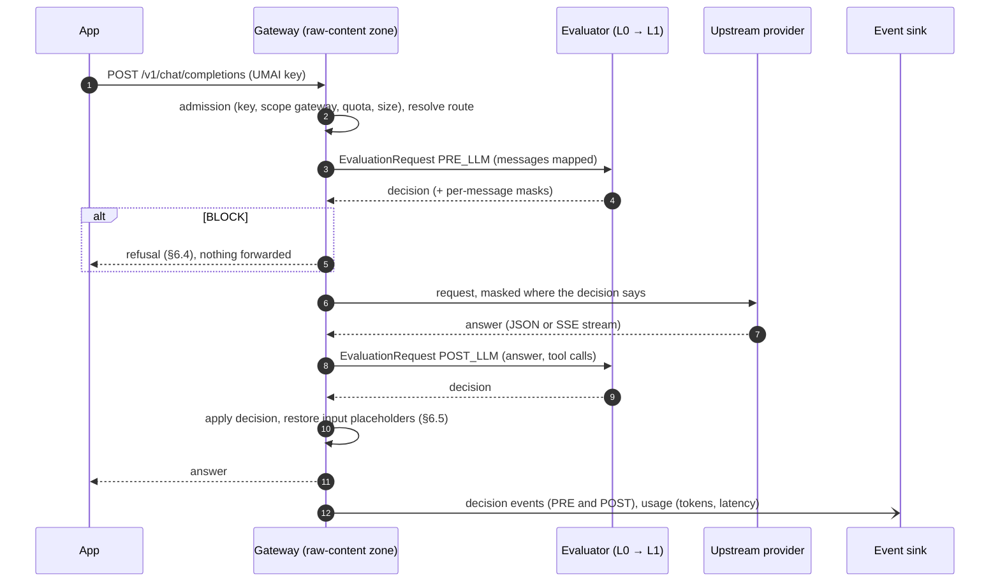
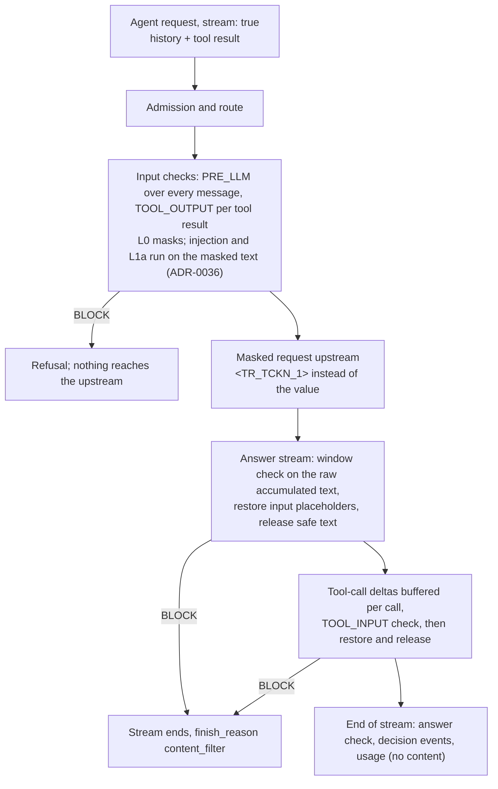

# UMAI secure gateway

**Status:** design accepted 2026-10-19 ([ADR-0034](../adr/0034-umai-secure-gateway.md),
[ADR-0035](../adr/0035-raw-content-zone-l0-and-gateway.md),
[ADR-0036](../adr/0036-checks-continue-after-masking.md)); contract
[`gateway-api`](../contracts/gateway-api.md) 0.1 drafted; nothing built (WP2 onward, §8). Open
product questions: Q46–Q52 in [`../open-questions.md`](../open-questions.md). Market and vendor
facts (verified 2026-10-19): [`../reference/ai-gateways.md`](../reference/ai-gateways.md).

## 1. The question and the short answer

Can UMAI also be used as an **AI gateway**: an application points its OpenAI-compatible client
at UMAI instead of at the model provider; UMAI applies the tenant's guardrail to the request,
forwards it, applies the guardrail to the answer and returns it?

**Technically, yes, and the engine is closer to it than it looks.** The phases, roles, decision
vocabulary and masking a gateway needs already exist, and the pipeline can be called
in-process (§3). Missing are the data plane (forwarding, streaming, provider credentials, the
providers' wire formats) and three rule-level changes: the raw-content rule must name the
forwarder, the threat model gains an upstream boundary, and UMAI moves into the availability path
of the customer's AI (§4, §7).

**As positioning, "AI gateway" alone is the wrong battlefield.** Routing, fallback, caching,
budgets and an OpenAI-compatible endpoint are free in LiteLLM, agentgateway and Agent Router, and
bundled in Azure API Management and Cloudflare; Portkey was bought by Palo Alto Networks and
Helicone went into maintenance mode. Gateways already ship Presidio masking, and LiteLLM ships a
*decision-model guardrail* that asks yes/no questions of `/v1/decisions` models such as Jev, which
is a commodity version of our L1b. What gateways do not have is UMAI's depth: Turkish and
European identifiers with checksums and context, signed policy-as-data with golden tests,
decision provenance, no prompt logging, self-hosted and air-gapped installs, and (proposed here)
reversible masking that keeps identifiers away from providers abroad. No Turkish AI gateway or
LLM firewall was found.

**Recommendation.** Position UMAI as *the guardrail and decision layer for regulated Turkish and
EU AI traffic*, delivered two ways:

1. **Inside the gateway the customer already runs** (option A): adapters for the external-guardrail
   hooks of LiteLLM, Portkey / Prisma AIRS, agentgateway, Kong and Azure API Management. Cheap,
   no rule change, rides a channel every acquired security vendor kept.
2. **As a thin UMAI security gateway** (option B) for customers without one, above all
   self-hosted and BDDK-regulated customers: OpenAI- and Anthropic-native pass-through with
   guardrails in and out, streaming, reversible masking, minimal routing.

Do not build a full LLMOps gateway (option C). If a high-throughput data plane is needed later,
put agentgateway in front of UMAI rather than embedding LiteLLM (option D, §5).

### 1.1 First customer (product owner, 2026-10-19)

A customer asks for a secure AI gateway that resists prompt injection, is tested in Turkish and
supports KVKK compliance; the product owner sees no such product in Türkiye and wants to fill the
gap in UMAI Cloud and on-prem, with AI governance packages as a later extension.

| Question | Answer | Consequence |
|---|---|---|
| Cloud or on-prem | Either; EU processing is acceptable to this customer | A cloud pilot is possible in the EU region (Q21 does not block this customer; it stays open for others) |
| Upstream models | OpenAI, Azure OpenAI, and models on their own servers | All three speak the OpenAI wire format: Chat Completions and Responses cover them; Anthropic Messages can wait |
| Traffic | Streaming chat, API calls and agents (tool calls, MCP) | Streaming (G2) and tool checks (G3) are in the first customer scope, not optional |
| Timeline | None; focus on what can be built well | §8 is ordered by dependency and value, not by date |

Their headline requirement, prompt-injection resistance in Turkish, is the part UMAI has least
of today (L1 is not implemented). No vendor can promise resistance to *all* injection methods;
what UMAI can promise is measured, published detection and false-alarm rates on a Turkish attack
set plus layered controls (§8 WP4).

## 2. Decision service today, gateway tomorrow

| | Decision service (today) | A: hook in their gateway | B: UMAI gateway |
|---|---|---|---|
| Customer integration | Two calls per LLM call; enforcement and redaction in their code | Gateway configuration | Change `base_url` and key |
| Who enforces | The caller | Their gateway | UMAI |
| Content UMAI sees | What is sent to evaluate (already raw) | Same | Every request and answer, both directions |
| Credentials UMAI holds | UMAI keys | UMAI keys | UMAI keys, possibly provider keys |
| UMAI down | Caller's failure policy | Their hook's failure setting | The customer's AI is down (or unguarded) |
| Streaming | Caller's problem | Their gateway's problem | UMAI's problem |
| Rule changes | — | None (contract change only) | ADR-0005 amendment, threat model |

## 3. What already fits

| Gateway need | Already in the engine |
|---|---|
| Hook points: input, output, tool arguments, tool results, MCP | `Phase` `PRE_LLM`, `POST_LLM`, `TOOL_INPUT`, `TOOL_OUTPUT`, `MCP_REQUEST`, `MCP_RESPONSE`; guardrail policy `roles` `user`, `assistant`, `tool_call`, `tool` (policy-bundle 0.6) |
| Chat-shaped input | `content.messages[]` with `system / user / assistant` roles, `focus`, `l0.target` (`LAST_MESSAGE` … `FULL_CONTEXT`) |
| Gateway actions | `ALLOW` → forward; `ALLOW_WITH_MODIFICATIONS` → forward masked; `BLOCK` → refuse; `MONITOR` mode → shadow rollout with `would_have` |
| Masking | L0 placeholders `<TYPE_n>`, same value → same placeholder within one evaluation: the basis for reversible masking (§6.5) |
| Speed of the inline check | L0 p95 11 ms on 4 kB with all 27 types (catalog report 2026-10-17); an L0 detection is terminal, so a masked or blocked request spends no model tokens |
| Tenancy | Per-tenant API keys with scopes and rate limits at admission (ADR-0023), tenant-owned hot-reloaded bundles, organizations |
| Failure semantics | `on_evaluation_failure`, `degraded`, no silent fail-open (AGENTS rule 4) |
| In-process reuse | `pipeline.orchestrator.Evaluator.evaluate(EvaluationRequest)`: no network hop between proxy and guardrail |
| Residency model | One stack per region; provider registry entries declare processing regions |
| Packaging | One image already runs two FastAPI apps (engine, policy service); a third entry point fits |

## 4. What is missing

| Gap | Why it matters | Needed for | Where it lands |
|---|---|---|---|
| **Per-text / per-message results** | `output_modifications.redacted_text` is one string over the *scanned* text. LiteLLM's hook needs masked `texts[]` 1:1 with what it sent; a gateway must rewrite each message and content part in place | A and B | evaluation-api change (skill `change-contract`) |
| Hook adapters | Each gateway has its own payload and verdict shape (reference §6) | A | Adapter routes in `api/`, one module per gateway |
| Forwarding (the proxy itself) | The product | B | New `gateway/` package (§6.14) |
| Provider wire formats: content parts, `developer` and `tool` roles, `tool_calls`, typed Responses items, Anthropic content blocks, SSE events, error objects | The engine's message `content` is a string; roles are `system/user/assistant` | B | New contract `gateway-api` 0.1; mapping in §6.3 |
| Streaming output checks | Most chat UIs stream; sent bytes cannot be recalled | B | §6.6 |
| Reversible masking | A masked prompt makes the answer refer to `<TR_TCKN_1>`; users expect their own value back | B | §6.5 |
| Provider credentials | Either UMAI stores the customer's provider keys (custody) or the app passes them through | B | §6.8, ADR-0027 |
| Route configuration | Upstream, model, guardrail, stream mode, refusal style | B | §6.8; tenant store (ADR-0025) |
| Metering unit | Today one evaluation = one request; a gateway call is 1–N evaluations plus provider tokens | A and B | §6.10, ADR-0028 |
| Raw-content rule | ADR-0005 lets raw content exist only in L0; a forwarder handles raw content by definition | B | §7 |
| Threat model | New boundary to the provider; tenant-configured upstream URLs (SSRF); provider keys; availability; gateways are prime supply-chain targets (LiteLLM's PyPI compromise, 2026-03-24) | B | §7 |
| Prompt-attack detection | Gateway buyers expect prompt-injection and jailbreak screening; UMAI has it only as planned L1b policies (L1 not implemented) | A and B | §8 WP4 (Q52) |
| **Injection checks skipped after masking** | ADR-0014 ends the evaluation at the L0 gate whenever an entity is detected, including `ALLOW_WITH_MODIFICATIONS` and exception `ALLOW`. If injection detection lives in L1, adding an e-mail address to a prompt skips it | A and B | ADR-0036: an L0 `BLOCK` / `STEP_UP_APPROVAL` stays terminal; a masking or exception outcome continues to the later checks on the **masked** text |
| Observability buyers expect | LLMOps gateways log full prompts; UMAI must not (AGENTS rule 1) | B | §6.12: metadata, tokens, cost, decisions, redacted excerpts only |
| Evidence | Added latency per call, streaming hold-back cost, masking survival rate | A and B | §8 (AGENTS rule 6) |

## 5. Options

| Option | What it is | For | Against |
|---|---|---|---|
| **A. Integrations** | UMAI as the guardrail behind other gateways' hooks: LiteLLM *Generic Guardrail API* (block or rewrite texts, fail-closed default), Portkey webhook (verdict plus full-body transform; **timeout = pass unless "Fail on Error" is set**), agentgateway webhook (reject or mask; no masking of streams), Kong *AI Custom Guardrail* (Enterprise, documented as allow / block only), Azure API Management `send-request` policy fragment (its built-in `llm-content-safety` calls only Azure AI Content Safety) | Cheapest; established channel; no data-plane or availability ownership; no rule change; reaches Azure customers through APIM | UMAI is one entry among ≈ 50 in LiteLLM; each hook has different masking and streaming limits; their failure defaults must be overridden in our docs |
| **B. Security gateway** | Thin native pass-through proxy in this repo: OpenAI Chat Completions and Responses, Anthropic Messages; guardrails in and out; streaming modes; reversible masking; one upstream per route with optional fallback | Drop-in product; reversible masking is the KVKK story; the natural form for self-hosted and bank customers who must keep traffic in Türkiye; same image and tenancy | UMAI owns availability, streaming, provider-API drift and (later) key custody |
| **C. Full AI gateway** | B plus load balancing, semantic caching, budgets per user, cost analytics, prompt management, model catalog | Bigger deal size if it wins | Commoditised and consolidating category; competes with the platform-first priority; prompt logs and caching collide with rule 1 |
| **D. Embed an open-source gateway** | Ship an existing gateway as the data plane with UMAI as its guardrail | Routing and provider breadth for free | LiteLLM: per-key guardrails are Enterprise, 2026 supply-chain compromise and CVEs, a second Python stack to secure. agentgateway (Apache-2.0, Rust, webhook mask, MCP authorization, vendor-reported p99 ≈ 2 ms) is the better data plane **if** throughput ever demands one |

Recommendation: **A first, then B**; C out of scope; D only as agentgateway in front of UMAI if
measurements show B's Python data plane is the bottleneck.

## 6. Design (option B, ADR-0034)

### 6.0 Target picture at WP5

### 6.1 One call

### 6.2 Surface

Per-region hostnames as for the engine API (ADR-0026), e.g. `eu.gateway.<domain>`. Native
surfaces, no translation between them (translation loses features; Anthropic itself calls its
OpenAI-compatibility layer not production-ready): OpenAI **Chat Completions** first (still
supported), then OpenAI **Responses** (recommended by OpenAI for new projects) and **Anthropic
Messages**; Azure OpenAI v1 and OpenAI-compatible self-hosted servers (vLLM, Ollama) as
upstreams of the OpenAI surfaces; `POST /v1/embeddings` with input checks only. Each surface is a
versioned section of contract [`gateway-api`](../contracts/gateway-api.md) (0.1: Chat Completions);
shapes are re-verified before implementation (rule 7).

### 6.3 Mapping a request to an evaluation

| Provider request | `EvaluationRequest` |
|---|---|
| roles `system`, `developer` | `system` |
| roles `user`, `assistant` | same; tool-call arguments → separate `TOOL_INPUT` evaluation per call |
| role `tool` / tool-result blocks | separate `TOOL_OUTPUT` evaluation, `action.tool_name` from the matching call (indirect prompt injection lands here) |
| text content parts | concatenated per message with offsets kept, so masks map back to parts |
| image / audio / file parts | route setting: `reject`, or `pass_unscanned` recorded as `degraded` (Q12) |
| `user` field, `x-umai-session-id`, `x-umai-subject-*` headers | `subject.user_id`, `session_id`, `role`, `department` (answers Q10 for gateway callers) |
| route's upstream and class | `destination.app` (`<provider>/<model>`), `destination.class` (`external_llm`, `internal_llm`) |
| route's guardrail | `bundle.id` (active version) |

### 6.4 Decision → gateway action

| Decision | Request (`PRE_LLM`) | Answer (`POST_LLM`) |
|---|---|---|
| `ALLOW` | forward | return |
| `ALLOW_WITH_WARNINGS` | forward; header `x-umai-decision` | return; header |
| `ALLOW_WITH_MODIFICATIONS` | forward the masked messages | return masked (entities the model produced stay masked) |
| `STEP_UP_APPROVAL` | refuse with code `umai_step_up_required` (an API has no approval UI) | as `BLOCK` |
| `BLOCK` | refuse; nothing reaches the provider | replace the answer with a refusal, `finish_reason: content_filter` |
| `MONITOR` mode | forward unchanged; `would_have` recorded | return unchanged |

Refusal style is a route setting (Q48): the provider's error object with HTTP 400 and code
`umai_blocked` (what SDKs raise as an exception, and what LiteLLM does on a block), or HTTP 200
with a refusal message for chat UIs that cannot show errors. Reasons follow the evaluation API:
entity types and policy ids, never values.

### 6.5 Reversible masking

L0 already numbers placeholders per type and maps the same value to the same placeholder within
one evaluation. The gateway keeps the placeholder → value map **in memory for the life of the
call only** (never persisted, logged or sent to L1 / L2), forwards the masked prompt, checks the
answer, then restores the input's placeholders in the answer. **Exact match only**: fuzzy
restoration (as LLM Guard offers) can put a wrong person's value back. Placeholders the model
altered or invented stay as they are. Multi-turn chats need no state: the app re-sends the
history, which is masked again in the next call.

This is what makes the gateway more than a filter: the provider never receives the TCKN or IBAN,
and the user still gets a useful answer. Whether pseudonymised prompts change the KVKK Art. 9 /
GDPR transfer position is a legal question (Q51), not an engineering claim. Before the feature is
offered, a `masking-survival` eval measures how often each provider keeps placeholders intact, per
placeholder format.

### 6.6 Streaming

| Mode | How | Cost | Guarantee |
|---|---|---|---|
| `buffer` | Collect the whole answer, check, then send | Time to first token = full generation time | Same as non-streaming |
| `window` (proposed default) | Hold back a tail of *k* characters (longest entity plus context, e.g. 128), re-run L0 on the **raw** accumulated text (never on already-masked text), release what is safe; on `BLOCK` end the stream with `finish_reason: content_filter` | One L0 pass per release step; a short tail delay | L0 entities never leave unmasked; L1b output policies run at the end and can only record |
| `after` | Stream unchanged, check at the end, record | None | Detection only |

Tool-call arguments stream as partial JSON; each call is buffered until complete before its
`TOOL_INPUT` check. Restoration of placeholders also holds back an unfinished `<TYPE_` sequence.
Routes whose guardrail has L1b output policies use `buffer` or accept detection-only. Prior art
uses the same three shapes (APIM 1 000-character windows, NeMo chunk and context sizes, LiteLLM
sampling and end-of-stream checks; reference §6.2).

### 6.7 Tool calls and MCP

Tool definitions pass through. Three check points: tool-call arguments (`TOOL_INPUT`, data
exfiltration, L1a rules over `action.*`), tool results (`TOOL_OUTPUT`, indirect prompt injection
and PII coming back), and tool descriptions at `tools/list` (poisoned tools). Allow-lists and
authorization stay deterministic code (rule 3). An MCP gateway surface (`MCP_REQUEST` /
`MCP_RESPONSE`) is a later stage; through option A, LiteLLM's and Portkey's MCP guardrail hooks
reach it earlier.

### 6.8 Routes and provider credentials

A **route** is tenant configuration, not policy: `route_id`, upstream (provider kind, base URL
from an allow-list, model), credential reference, guardrail (bundle id), stream mode, refusal
style, explicit timeouts, optional fallback route. Routes live in the tenant store (ADR-0025),
are edited in the console through the policy service and hot-reloaded; every decision event
records the route id. The guardrail itself stays in the signed bundle (rule 8).

Provider credentials (Q47):

- **Pass-through first:** the app sends its provider key; UMAI forwards it and stores nothing.
- **Stored (BYOK) later:** per-tenant envelope encryption under the Key Vault key of ADR-0027 /
  ADR-0031, decrypted only in the gateway, never returned by any API; managed identity instead of
  keys for Azure OpenAI upstreams. Self-hosted installs use settings or their own secret store.

Upstream base URLs come from a provider allow-list (no private addresses, no arbitrary hosts)
against SSRF; self-hosted installs may add internal model servers explicitly.

### 6.9 Failure and availability

- Guardrail failures are already decisions (the bundle's failure policy); the gateway applies
  them like any other decision.
- Upstream errors and timeouts pass through in the provider's error shape and are recorded; they
  are not guardrail decisions. Optional fallback route on 429 / 5xx / timeout.
- Every call has an overall deadline; the guardrail budget is part of it.
- UMAI becomes part of the customer's AI availability: the regional multi-replica stack
  (ADR-0031) is a prerequisite for SaaS gateway customers; the single-VM starter (ADR-0032)
  stays demo-only.

### 6.10 Tenancy, metering, editions

- Keys need a `gateway` scope (credentials contract); admission is the same as for evaluate.
- Meters (ADR-0028): `gateway_calls` plus the evaluations they caused, and provider-reported
  token usage per route for the customer's cost view. What a Community "request" is: Q49.
- Gateway access is an entitlement feature (`gateway`), never an edition-name branch.
- The 8 000-token prompt limit applies to the request content as today.

### 6.11 Residency

The EU stack forwards only to upstreams whose declared processing region the tenant allows (e.g.
EU data-zone deployments); the route allow-list carries regions like the provider registry. A
tenant may knowingly choose a non-EU upstream; the choice is recorded and visible.

### 6.12 Observability without prompts

Logged and stored: ids, route, upstream model, decision, entity types, tags, latency per stage,
provider status, token usage, cost estimate, redacted excerpts in decision events (as today).
Never: prompts, answers, provider keys. A deliberate difference from LLMOps gateways and part of
the positioning.

### 6.13 Self-hosted

Same image and configuration; upstreams may be the customer's own model servers (vLLM, Ollama,
Azure OpenAI in their tenant). Guardrail and gateway in one install with no content leaving the
network: the only form a bank under BDDK rules can use.

### 6.14 Code placement

New package `gateway/` (entry point `umai_decision_engine.gateway.app:app`, own port) in the same
image. It is a **raw-content zone** like `l0`: prompts and answers live in memory only, logging
goes through the raw-content guard, and it calls the `Evaluator` in-process. It may import
`pipeline`, `contracts`, `tenancy`, `settings`; it must not import `l1` or `l2` internals, and
nothing imports it. Upstream calls use httpx async with explicit timeouts and no retries inside
the guardrail budget (as for L1b adapters). Option A's adapters are routes in `api/`, not part
of `gateway/`.

## 7. Rule and document changes

| Change | For | Where | State |
|---|---|---|---|
| UMAI secure gateway: option B, technology, routes, credentials | B | ADR-0034 | done (WP1) |
| An L0 masking or exception outcome is a floor; later checks run on the masked text (an L0 `BLOCK` stays terminal) | A, B | ADR-0036; merge rule 0, overview, L0 doc | done (WP1); effective with L1 |
| Raw content may exist in L0 **and the gateway forwarder**, memory only, leaving only to the caller and the route's upstream after the guardrail allowed it | B | ADR-0035; AGENTS rule 1; code-layout | done (WP1) |
| Trust boundary TB7, assets A11–A12, gateway threats | B | Threat model | done (WP1); gap analysis with WP2 |
| Contract `gateway-api` 0.1 | B | `contracts/gateway-api.md` | drafted (WP1) |
| Feature matrix row, entitlement feature `gateway`, planned contract changes | B | deployment-and-editions | done (WP1) |
| Per-message masks, scan of every forwarded message, one placeholder namespace per call | A, B | evaluation-api + model + pipeline (skill `change-contract`) | WP2, with its code |
| `gateway` scope; `route_id`, `source: gateway` on decision events | B | credentials, tagged-action | WP2, with their code |
| Leak suite over adapter responses, gateway logs, events and error bodies | A, B | evals | WP2 exit |
| Recommended failure settings per integration (e.g. Portkey "Fail on Error" on) | A | integration docs (rule 4) | with the adapters |

## 8. Build plan for the first customer

Work packages in dependency order. "Now" means it needs nothing that does not exist today.

| WP | Scope | Needs | Exit evidence |
|---|---|---|---|
| **WP1 Decisions and contracts** | ADR: UMAI security gateway (option B; A later; no LiteLLM core). ADR amending ADR-0005 (forwarder as raw-content zone) and ADR-0014 (injection checks after masking). Contracts: `gateway-api` 0.1 (Chat Completions), evaluation-api per-message masks, credentials `gateway` scope | Product-owner approval | **Done 2026-10-19** (contract changes to existing code move to WP2) |
| **WP2 Gateway core (G1)** — done 2026-10-19 | `gateway/` package; Chat Completions non-streaming; upstreams OpenAI, Azure OpenAI v1, OpenAI-compatible self-hosted (vLLM, Ollama); pass-through provider keys; routes; PRE / POST L0 checks; masking; refusals; `MONITOR`; usage from provider `usage` | WP1 | Done: 37 integration tests incl. the official `openai` SDK; added p95 7.5 ms (500 chars) to 26 ms (4 kB, masked) ([gateway-latency](../../evals/reports/2026-10-19-gateway-latency-wp3/summary.md)); routes are per tenant by file. Leak: gateway logs checked in tests; the `leak` suite over gateway paths is open (N2) |
| **WP3 Streaming and reversible masking (G2)** — done 2026-10-19 | `buffer` / `window` / `after`; placeholder restoration (exact match); tool-call argument buffering | WP2 | Done: window cost 85 ms CPU over a 2 000-character answer, first words after ≈ 160 characters (N13); [masking-survival](../../evals/reports/2026-10-19-masking-survival-wp3/summary.md): 0 placeholders altered, 93–100 % kept and restored (OpenAI `gpt-4.1-mini`, `gpt-5.4-mini`); Azure OpenAI and self-hosted upstreams still to measure |
| **WP4a Turkish attack set** — groundwork done, paused | Synthetic `pi-tr` eval suite: direct override, role-play and jailbreak, system-prompt extraction, indirect injection in documents and tool results, obfuscation (base64, leetspeak, dotless-i and diacritic tricks, homoglyphs), Turkish–English code-switching, multi-turn; hard negatives (security discussions, quoted attacks) | **Now** | Dataset, suite, baseline report |
| **WP4b Injection detector choice** — first measurement, paused | Measure CPU-capable multilingual candidates on `pi-tr` (laya-multilingual, Vela Guard 307M, Qwen3Guard; reference `onprem-decision-models.md`) for recall, false alarms, p95 | WP4a; model downloads (product-owner approval) | Report and ADR naming the default detector (Q1 for injection) |
| **WP4c Injection checks in the pipeline** — paused | Detector behind a provider interface; runs on input, tool results and documents, on masked text after an L0 masking outcome; L1a deterministic tool-call rules (allow-lists, high-impact actions) | ADR-0036, WP4b | `pi-tr` test-split rates published; latency within the gateway budget |
| **WP5 Agents (G3)** | Tool-call and tool-result checks in the gateway; Responses API surface; MCP later | WP2, WP4c | Tool-call evals; Responses contract tests |
| **WP6 Records** | Decision events and usage ledger with route, model, app, user fields (ADR-0030, ADR-0028): the customer's dashboard and the base for governance packages | Platform-first track | Events stored per tenant; leak suite over events |
| **WP7 Console** | Routes, gateway keys, usage and decision views (`umai-control-center`) | WP1 contracts | Console end to end against a local stack |
| **WP8 Pilot deployment** | Cloud pilot on the EU single-VM starter (ADR-0032 allows pilots) with a gateway hostname; on-prem with the same image and Compose | WP2, WP3 | Pilot runbook; customer traffic in `MONITOR` mode first |

**WP4 paused (product owner, 2026-10-19):** the engine has only L0 today; prompt-attack work resumes with L1, and guardrail tests come then. Groundwork kept: the `pi-tr` set (356 generated cases + 65 handwritten holdout cases), detector code in `l1/attacks/` (not wired into the pipeline) and first measurements: open classifiers miss Turkish (Vela Guard, Prompt Guard 2 ≤ 10 % recall; ProtectAI 55 % recall at 24 % false alarms on the holdout), the keyword heuristic does not generalise (holdout recall 15 %), an LLM judge over an OpenAI-compatible endpoint does (holdout 100 %, test 96–98 %, 0–4 % false alarms; p50 0.7–1.1 s, so it would run in parallel with the upstream call). Reports: `evals/reports/2026-10-19-pi-tr-wp4b*`.

What the customer asked for is WP2 + WP3 + WP4 + WP5; WP4a can start today in parallel with
WP1. Integrations into other gateways (option A, adapters for LiteLLM, Portkey, agentgateway,
Kong, Azure API Management) follow once WP1's per-message masks exist.

## 9. Notes for later

Found while building WP2–WP5; none blocks the first customer's pilot.

| # | Note | Where it belongs |
|---|---|---|
| N1 | Routes are YAML files per tenant written by the operator; tenants cannot edit them yet | WP7: tenant store + policy service + console |
| N2 | Decision events are not stored (no event sink yet); `X-Umai-Event-Id` names an evaluation that only the logs record | WP6 (ADR-0030) |
| N3 | `window` streams run one full pipeline evaluation per release step; each logs a `decision` line. Fine for L0; with injection detection (WP4) on every step, measure cost and consider checking attacks only on the whole answer | WP4c benchmark |
| N4 | A value masked inside tool-call arguments is stored as JSON source text; restoring it into plain content would show JSON escapes (only matters for values with quotes or backslashes) | gateway masking |
| N5 | `include_usage` is added only for `openai` / `azure_openai` upstreams; self-hosted servers may report no usage in streams | usage ledger (WP6) |
| N6 | Upstream region is recorded, not enforced per tenant | regional stack (ADR-0026) |
| N7 | The upstream allow-list checks host names, not what they resolve to (DNS pointing an allowed name at a private address) | before tenant-edited routes (WP7) |
| N8 | Every turn re-scans the whole history; long agent conversations cost L0 time per turn. A per-message decision cache keyed by HMAC (no content) is possible if measurements ask for it | gateway benchmark |
| N9 | Engine and gateway processes keep separate per-key rate-limit buckets | Redis buckets (ADR-0023 §7) |
| N10 | Docker image and Compose: the gateway needs its own service, port 9300 and a Caddy hostname | WP8 |
| N11 | OpenAI Responses API and Anthropic Messages surfaces | after WP5 |
| N13 | `window` streams show the first words after about hold-back + step = 160 upstream characters (≈ 0.4 s at 100 tokens/s, ≈ 1 s at 40 tokens/s; [report](../../evals/reports/2026-10-19-gateway-latency-wp3/summary.md)). A smaller hold-back halves that but lets entities longer than it (long URLs, API keys) be released in part before they are recognised; the rest is then never released. 128 stays the default until a customer asks | route or deployment setting |
| N12 | The OpenAI key used for live tests sits in the tracked file `.env.example` of the main checkout (not committed by this work): move it to `.env` (ignored) and rotate it if it was ever pushed | product owner |

## 10. Decisions needed

Answered: Q45 positioning (A17, ADR-0034). Open: Q46 when · Q47 provider-key custody · Q48
refusal style · Q49 metering unit · Q50 streaming default · Q51 reversible masking and KVKK /
GDPR · Q52 prompt-attack detection before a gateway launch. See
[`../open-questions.md`](../open-questions.md).
