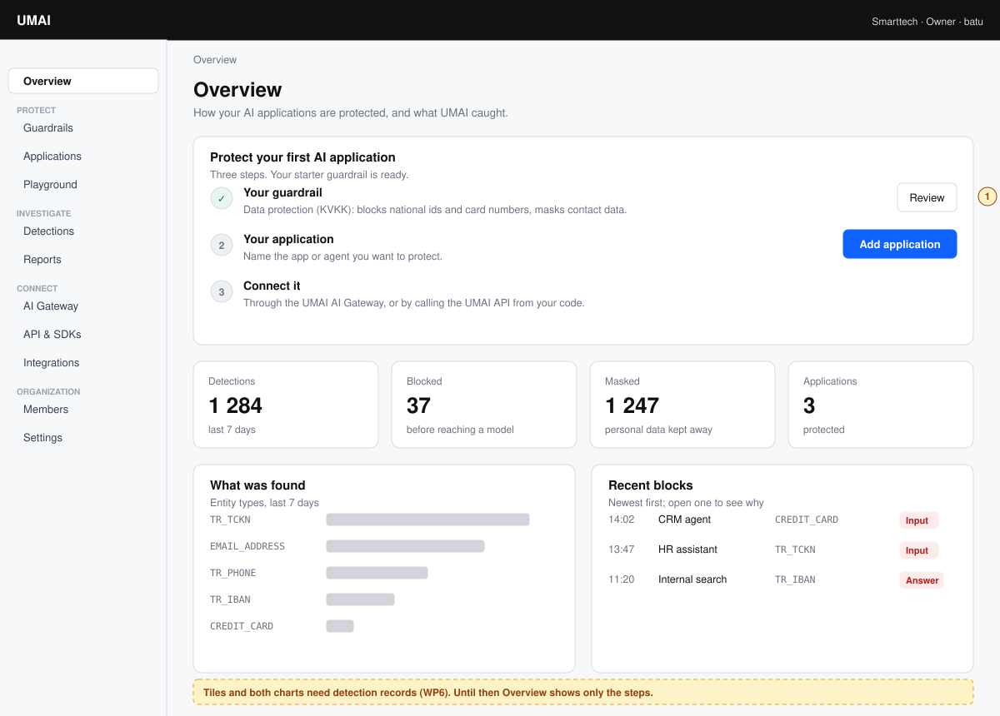
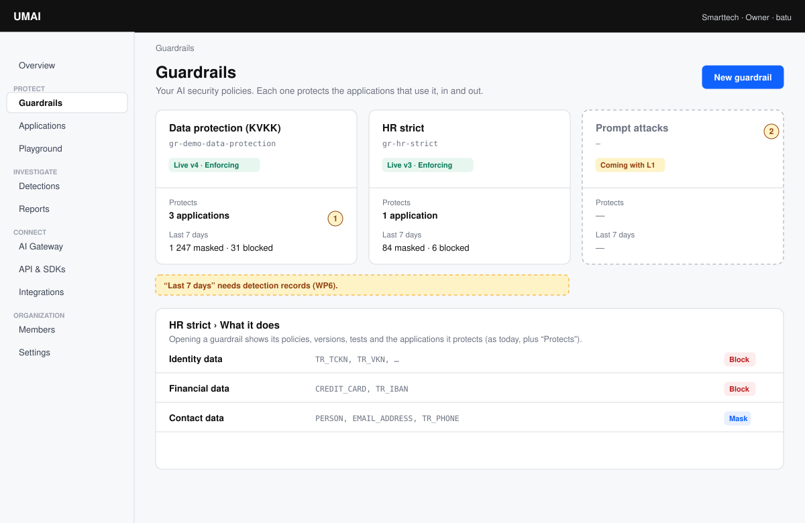
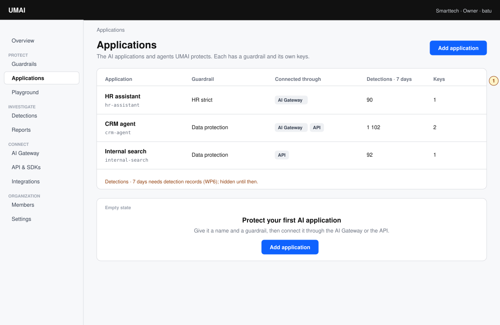
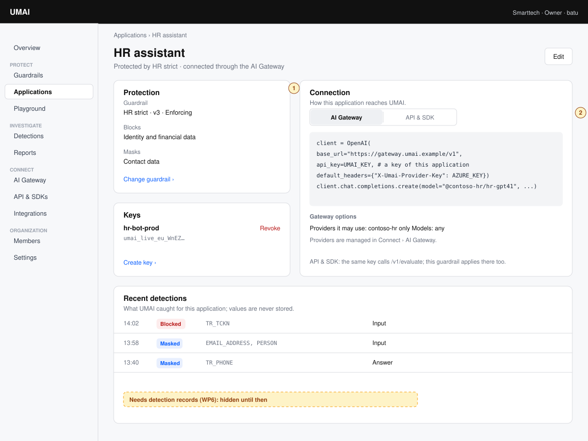
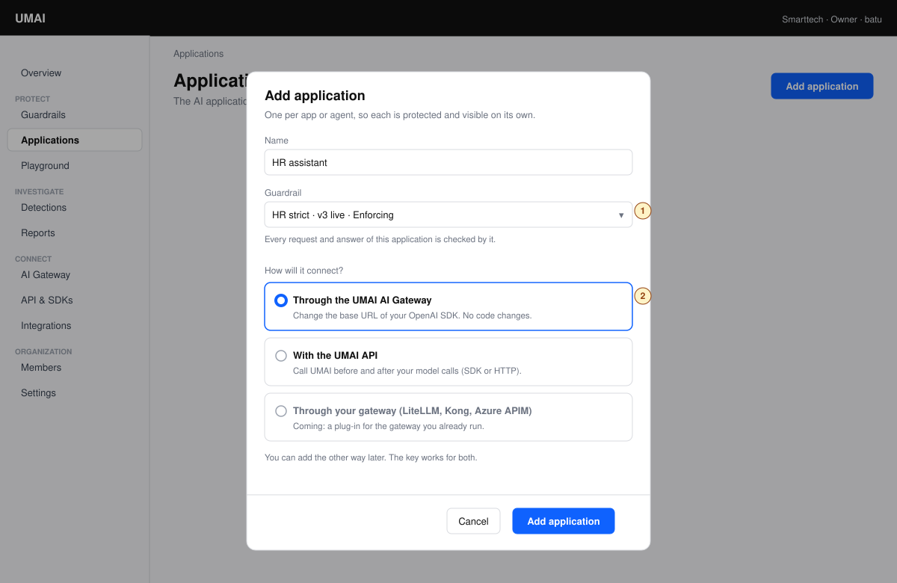
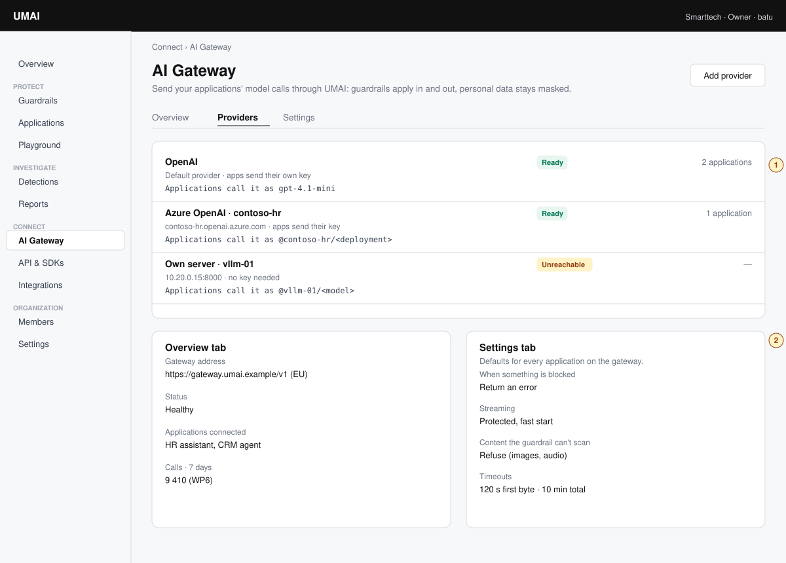
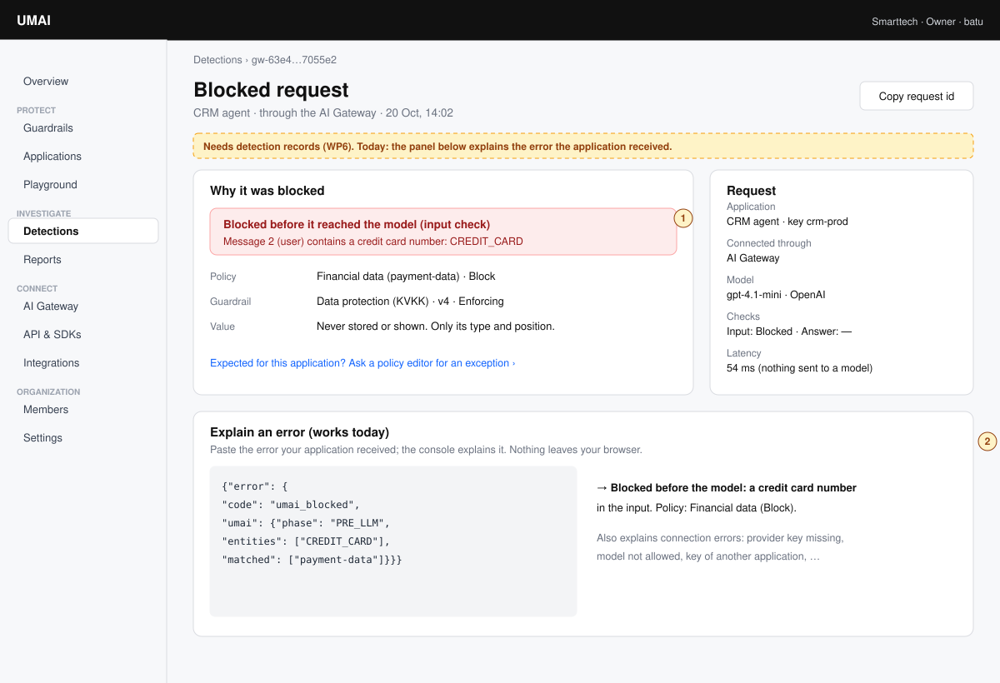

# Console: information architecture for an AI runtime security product

**Status:** proposal for decision (2026-10-20, second design). The object model is drafted as
[ADR-0039](../adr/0039-applications-and-connections.md) (Proposed). Nothing in the engine, the
contracts or the console has changed for this document.
**Scope:** the console's structure in `umai-control-center` (ADR-0016) and the engine changes the
ADR would need if accepted.
**Builds on:** [overview](overview.md), [gateway design](ai-gateway.md) §1 (positioning),
[gateway-api](../contracts/gateway-api.md) 0.9, [ADR-0038](../adr/0038-gateways-instead-of-model-routes.md),
the console's `docs/design.md`.

## 0. Why a second design

The first design (same day) was organized around the gateway: providers, applications and keys
appeared to exist for it, and the guardrails were one item among many. That contradicts what UMAI
is and what this repository already recorded:

- UMAI is an **AI runtime security** product: it decides, inline, whether an AI interaction may
  proceed (L0, L1), and reviews afterwards (L2) ([overview](overview.md)).
- The gateway analysis concluded that "AI gateway" alone is the wrong battlefield, and positioned
  UMAI as *the guardrail and decision layer for regulated Turkish and EU AI traffic*, delivered
  inside the customer's gateway or through a thin UMAI gateway ([ai-gateway.md](ai-gateway.md) §1,
  A17).

So the console leads with **what UMAI protects and what it caught**. The AI gateway is one way of
connecting an application, next to the API and, later, plug-ins for the gateways customers
already run. Its providers live under it.

## 1. What we start from

The raw findings of the first design still hold and are kept short here.

- **Console today:** Get started, Guardrails, Playground, Members. Guardrails are the most
  developed area (versions, Enforcing or Monitor, drafts, golden tests, publish). Keys exist only
  on Get started, with the scope `evaluate`. English only. Roles: owner, admin, policy editor,
  approver, viewer, billing; no developer role.
- **Engine today (PR #9):** guardrails evaluate requests from two enforcement points, the
  evaluation API (`/v1/evaluate`, the caller names the guardrail per request) and the gateway
  (`gateway-api` 0.9: gateways with one provider and one guardrail, keys bound to a gateway).
- **Records:** decision events and calls are log lines only (WP6 not built). They carry no key,
  application or entity types; refusals before the guardrail are not logged by the gateway.
- **umai-beta:** only our own test calls; no customer traffic yet.

### 1.1 How AI runtime security products organize their consoles

Read from the vendors' own documentation on 2026-10-20; sources in
[`reference/ai-gateways.md`](../reference/ai-gateways.md) §9. The first design compared AI
gateways; the right comparison is with runtime security products.

| Product | Protected object (carries one policy) | Where connection methods sit | First screen | Providers |
|---|---|---|---|---|
| CrowdStrike Falcon AIDR (formerly Pangea AI Guard) | **Collector**: name, one policy (or log only), token, install snippet, playground | One *Collectors* page, by type: application (SDK/API), **gateway** (Apigee, Azure APIM, Kong, LiteLLM, Portkey), agentic (MCP proxy), browser, endpoint | *Visibility*: user → application → provider → model flow, detections, drill-down into *Findings* | No provider page; provider and model arrive as event metadata |
| HiddenLayer AISec Platform | **Project** ("an AI use case"): exactly one policy, a project id header | Runtime deployed separately; gateways and SDKs listed in the docs' integrations | *Reports* (security dashboard); *Detections* by threat level and category | None in the console; the client passes its provider key through the proxy |
| Prompt Security (SentinelOne) | **Homegrown app** with its own policy (console details unverified) | By module (usage control, agentic, application security) | *Dashboards*: violations prevented, total prompts | Unverified |
| Palo Alto Networks Prisma AIRS | **Application** (API intercept): one AI security profile, one API key | Four peer pillars: runtime security (API and network intercept), supply chain, red teaming, and the **AI gateway**, which has its own workspaces, keys, policies and logs | *API Violations*: blocked transactions by content type, detector and severity, then a table and a per-request panel; *Applications* and *Sessions* views | **Only inside the AI gateway** (its Integrations page) |
| Lakera Guard (now Check Point AI Guardrails) | **Project**: one policy, mode Enforce or Detect (no code change), tags | No proxy of its own; gateways call the Guard API; agent platforms on an *AI Integrations* page | *Analytics*: requests, flagged, detection rate, per project; *Logs* with a Threats tab and request-id filter | None |

What this says for UMAI:

1. **One protected object with one policy** is the common shape: collector, project, app.
   UMAI's word for it is *application*.
2. **The gateway is a connection type, not a product area of its own.** CrowdStrike lists it next
   to SDK, MCP and browser on one page. That is UMAI's Connect section.
3. **The first screen is security**: flows, detections, violations prevented. Every chart
   drills down into a filtered list of findings, and a finding can be marked benign.
4. **Content stays hidden by role.** CrowdStrike has metadata-only roles; UMAI goes further and
   never stores content. That is the KVKK story to show on screen.
5. **Policy changes are simulated before they apply** (Lakera replays 30 days of traffic
   across sensitivity levels), and a protected object can run in *detect* mode before it is
   switched to *enforce*, without a code change.
6. **Navigation split by product module** (HiddenLayer, SentinelOne) and a gateway with its own
   workspaces, keys and policies (Prisma AIRS) make one application appear in several places.
   That is alternative B of §4.1, not recommended.

## 2. Roles and jobs

Unchanged from the first design, with security in front:

| Role | Day 0 | Day 1 | Day 2 | Incident |
|---|---|---|---|---|
| **Security / platform administrator** | Choose what to protect against (guardrails), register applications, connect them | — | Tighten a guardrail, add an application, rotate keys, see what was caught | Cut off one application |
| **Application developer** | — | Connect an application the way that suits it (gateway or API); see a detection happen | Understand why a request was blocked | Find the detections of their application |
| **Compliance / KVKK officer** | Approve guardrails | — | Evidence: what personal data was detected, masked or blocked, per application, over time; where data went | Show what left the company, to which provider and region |

The compliance officer and the administrator now meet on the first screen: **Overview** is the
security posture, not a setup page.

## 3. Information architecture

### 3.1 Navigation

```text
Overview         security posture; the three setup steps until the first application is connected
PROTECT
  Guardrails     what UMAI enforces: policies, versions, tests, publish (as today) + "protects"
  Applications   what UMAI protects: AI apps and agents, each with a guardrail, connections, keys
  Playground     try a guardrail on a message; "what the model receives"
INVESTIGATE
  Detections     every request where a guardrail found something: masked, blocked, flagged
  Reports        KVKK evidence over a period, per application, provider and data type
CONNECT
  AI Gateway     the UMAI gateway: address, providers, gateway defaults, connected applications
  API & SDKs     the evaluation API: endpoint, snippets, SDKs
  Integrations   plug-ins for gateways customers already run (LiteLLM, Kong, Azure APIM): later
ORGANIZATION
  Members
  Settings       region, data retention, audit log, single sign-on
```

Three ideas carry it:

1. **Protect → Investigate → Connect** reads as the product's story: what you enforce and on
   what, what was caught, and the plumbing. Plumbing is last.
2. **The AI Gateway is one way to connect**, beside the API and future integrations. Everything
   that only matters to the gateway lives under it: providers, provider keys, streaming and
   refusal defaults, timeouts. A customer who never uses the gateway never meets a provider.
3. **Applications are independent of how they connect.** An application has a guardrail and
   keys; it can be connected through the gateway, the API, or both, and its guardrail applies the
   same way on every path.

### 3.2 Where each object lives

| Object | Section | Notes |
|---|---|---|
| Guardrail | Protect | The core object. Each shows which applications it protects and, with WP6, what it caught |
| Application | Protect | The protected unit: guardrail, connections, keys, its detections |
| Key | Inside an application | One key works on every connection of its application; shown once |
| Detection | Investigate | A request where a check found something; the request id opens it. Values are never stored |
| Report | Investigate | A period, per application, provider and data type; exportable for the DPO (WP6) |
| AI Gateway | Connect | One per organization and region: its address, defaults and status |
| Provider | Connect › AI Gateway | Where the gateway sends model calls; one default; `@provider/model` picks another |
| API endpoint | Connect › API & SDKs | Address and snippets of `/v1/evaluate` |

### 3.3 Who sees what (ADR-0029 roles)

| Section | Owner | Admin | Policy editor | Approver | Viewer | Billing |
|---|---|---|---|---|---|---|
| Overview, Detections, Reports | read | read | read | read | read | — |
| Guardrails | edit | edit | edit | approve | read | — |
| Applications, keys | edit | edit | read | read | read | — |
| AI Gateway (providers, defaults), API & SDKs | edit | edit | read | read | read | — |
| Members, Settings | edit | edit | — | — | — | billing only |

Key secrets are never shown after creation, to anyone; content is never shown, to anyone
(ADR-0005).

### 3.4 What has data today

| Works today (PR #9 plus ADR-0039's changes) | Needs detection records (WP6) |
|---|---|
| Guardrails (as today), applications, keys, AI Gateway (providers, defaults), API & SDKs snippets, Playground, explaining an error the application received | Overview tiles and charts, Detections, Reports, per-application and per-guardrail counts, last use of a key, audit log |

**Before WP6, Overview shows only the setup steps and Detections shows only "Explain an
error".** The marked parts are drawn so that WP6 is designed for them: detection records must
carry the application, the key, the connection (gateway or API), the provider and the entity
types.

## 4. Object model

| Object | What it is to the user | Key attributes | Relations | Actions |
|---|---|---|---|---|
| **Guardrail** | What UMAI enforces | Policies, versions, mode (Enforcing, Monitor), tests | Protects many applications | As today; plus "protects", and with WP6 "caught" |
| **Application** | An app or agent UMAI protects | Name, guardrail, mode (Enforce, or Monitor only if Q-P5 is accepted), connections (AI Gateway, API), gateway options (allowed providers, model names, aliases), state | Uses one guardrail; has keys; has detections; may use providers through the gateway | Add, edit, change guardrail, disable, delete (refused while keys are active) |
| **Key** | The secret an application sends | Name, prefix, created by and at, last use (WP6), expiry, state | Belongs to one application; valid on all its connections | Create (shown once), revoke |
| **Detection** | A request in which a check found something | Time, application, key, connection, provider and model (gateway), checks and their decisions, entity types, policy ids, guardrail version, latency, request id; never values | Belongs to an application; points to a guardrail version | Open, explain, copy request id, filter (WP6) |
| **AI Gateway** | UMAI's gateway, one way to connect | Address per region, status, defaults (when blocked, streaming, unscanned content, timeouts) | Has providers; serves applications connected through it | Settings, providers |
| **Provider** | Where the gateway sends model calls | Name (`@name/` prefix), type, address, provider-key handling, region, default flag, status | Belongs to the AI Gateway of the organization; used by applications | Add, edit, make default, disable, remove |

What changed against the first design:

- **The application no longer belongs to the gateway.** It is the protected unit, connected by
  any method. Its guardrail is the guardrail of every request it makes, on the gateway *and* on
  the evaluation API; today an API caller names the guardrail in each request (§8 lists this
  engine change).
- **Providers are part of the AI Gateway**, not of the organization's top level. The data model
  is the same (one list per organization); its home and its explanation are the gateway's.
- **"Gateway" names the product area and its address,** never something an administrator
  creates per application. That was the root of the first confusion.

### 4.1 Alternatives for the structure

| | A. Gateway-centred (first design) | B. Two products side by side | **C. Security first, gateway under Connect** |
|---|---|---|---|
| Top level | Applications, Providers, Guardrails as peers | "Guard" and "Gateway" as separate products, each with its own applications and keys | Protect, Investigate, Connect, Organization |
| What a visitor learns first | How to route model calls | That there are two products | What UMAI protects and caught |
| A customer without the gateway | Meets providers anyway | Ignores half the console | Never meets a provider |
| An application on gateway and API | Two places | Two applications, two keys | One application, one key |
| Fits the positioning (A17) | No | Partly | **Yes** |
| Like | Gateway products (Portkey, LiteLLM) | Platform suites with separate modules | CrowdStrike AIDR (collectors by type), Lakera (projects), HiddenLayer (projects) |

**C** is recommended. B was considered because large security platforms sell the gateway as
its own product. For one console and one customer it would duplicate applications and keys and
make the guardrail look like one of two equals.

## 5. Four critical flows

### 5.1 Protect a first application (administrator and developer)

**Target:** the first protected request within 10 minutes, without documentation; three
decisions: application name, guardrail (preselected), how it connects.

1. **Overview** shows three steps while nothing is connected. Step 1, *Your guardrail*, is done:
   the organization's starter guardrail, *Data protection (KVKK)*, with one sentence on what it
   blocks and masks, and a *Review* link. Security leads. (W1)
2. **Add application:** name, guardrail (starter preselected), and *How will it connect?*: (W5)
   - *Through the UMAI AI Gateway*: change the base URL of the OpenAI SDK; no code change;
   - *With the UMAI API*: call UMAI before and after the model;
   - *Through your gateway* (LiteLLM, Kong, Azure APIM): shown as coming.
3. **The application page** opens with its key (shown once) inside the snippet of the chosen
   connection, and the other connection one tab away. (W4)
4. **Proof:** *Try it in the Playground* shows the masked text without a model call. With WP6,
   the first detection appears on the application's page and in Detections.

| State | What the user sees |
|---|---|
| Gateway chosen, provider is not OpenAI | "Your model runs on Azure or your own server? Add it under AI Gateway › Providers." with a link; the application is created anyway |
| Key not copied | Gone for good: "Create a new key" (secrets are not stored, ADR-0023) |
| First gateway call without the provider key | The snippet already carries `X-Umai-Provider-Key`; the explanation says why |
| API call names another guardrail than the application's | Refused (proposed `guardrail_mismatch`): the application's guardrail is the one that applies |

### 5.2 Add a provider (administrator; only for the gateway)

*Connect › AI Gateway › Providers › Add provider* (W6): type (OpenAI, Azure OpenAI, own server),
name (the `@name/` prefix), address checked against the allow-list while typing, provider key
(sent by the application; *stored in UMAI* waits for Q47), declared region, default or not.

| State | What the user sees |
|---|---|
| Address not allowed | "This address isn't allowed for your UMAI installation. Ask your UMAI operator to allow `<host>`." |
| Own server unreachable | Saved with an amber *Unreachable* tag and the last error |
| Removing a provider an application is limited to | Refused, naming the application |
| Changing the default provider | "Bare model names of every application on the gateway go to `<new>` from now on." |

### 5.3 A new application with a stricter guardrail (administrator, day 2)

*Applications › Add application* → "HR assistant" → guardrail *HR strict* (or *Create a
guardrail*, which returns here) → connection → create. Gateway options on the application page
limit it to providers that have a data-processing agreement for HR data (*contoso-hr only*).
Changing an application's guardrail later says: "Applies to the next request of HR assistant on
every connection." With WP6: "In the last 7 days HR strict would have blocked 14 of its
requests."

### 5.4 Investigate a detection (developer, compliance officer)

The application receives `400 umai_blocked` with `error.umai` (request id, phase, entity types,
policy ids; never values).

- **Today:** *Investigate › Detections › Explain an error*: paste the error; the console says
  in plain language what was found, by which policy of which guardrail, and how to ask for an
  exception. Connection errors (missing provider key, model not allowed, key of another
  application) are explained the same way. (W7, lower panel)
- **With WP6:** search by request id or filter by application, connection, data type, decision and
  time; the detection shows the application, key, connection, provider, model, the decision of
  every check, the policy and the guardrail version. (W7, upper panel)
- **Mark as expected** (CrowdStrike's "mark benign"): turns a detection into a proposed
  exception for a policy editor, through the guardrail's draft and golden tests, so feedback
  becomes policy the usual way (ADR-0015, ADR-0022).

## 6. Wireframes

Low fidelity, in the console's layout (top bar, grouped rail, page header, white cards on the
canvas, one blue primary action per screen). Amber circles mark the notes under each image; amber
dashed bars mark what needs detection records (WP6).



**W1 Overview.** The home page is the security posture. (1) Until an application is connected,
the three steps sit on top; step 1 is the guardrail, already done. The tiles and charts below
need WP6 and are hidden until then.



**W2 Guardrails.** (1) Each guardrail shows what it protects. (2) Future protections (prompt
attacks, with L1) appear where customers look for protection, as an honest "coming" card.



**W3 Applications.** (1) "Connected through" shows the method per application; counts need
WP6. The lower card is the empty state.



**W4 Application.** (1) Protection first: the guardrail and what it does. (2) Connection: the
gateway and the API as tabs of the same application and key; gateway options (allowed providers)
point to where providers are managed.



**W5 Add application.** (1) The guardrail is the decision that matters, preselected. (2) The
connection is chosen here and can be extended later; the plug-in path for existing gateways is
shown as coming.



**W6 AI Gateway** (Connect). (1) Providers live here, with how applications address them.
(2) Overview and Settings tabs: the gateway's address, the applications connected through it, and
the defaults every gateway call uses.



**W7 Detection.** (1) With WP6, a detection opened by request id. (2) Today, the explanation of
an error the application received.

## 7. Turkish interface text

| English | Türkçe |
|---|---|
| Overview | Genel bakış |
| Protect · Investigate · Connect · Organization | Koru · İncele · Bağla · Organizasyon |
| Guardrails | Guardrail'ler |
| Applications | Uygulamalar |
| Detections | Tespitler |
| Reports | Raporlar |
| AI Gateway | AI Gateway |
| API & SDKs | API ve SDK'lar |
| Integrations | Entegrasyonlar |
| Provider | Sağlayıcı |
| Blocked / Masked | Engellendi / Maskelendi |

| Where | Türkçe metin |
|---|---|
| Overview, steps | "İlk AI uygulamanızı koruyun. Başlangıç guardrail'iniz hazır." |
| Step 1 | "Veri koruma (KVKK): kimlik ve kart numaralarını engeller, iletişim bilgilerini maskeler." |
| Add application | "Uygulama ya da agent başına bir tane; her biri ayrı korunur ve ayrı görünür." |
| How will it connect | "Nasıl bağlanacak? UMAI AI Gateway üzerinden (OpenAI SDK'nızda yalnızca adres değişir) · UMAI API ile (model çağrısından önce ve sonra UMAI'yi çağırın) · Kendi gateway'iniz üzerinden (yakında)" |
| Key created | "Anahtarınızı şimdi kopyalayın. Yalnızca bir kez gösterilir; bu uygulamanın tüm bağlantılarında geçerlidir." |
| Gateway providers | "Gateway'in model çağrılarını gönderdiği yerler. Varsayılan sağlayıcı dışındakiler için modelin önüne @ad/ yazılır." |
| Explained block | "Modele ulaşmadan engellendi (giriş kontrolü): istekte bir kart numarası (CREDIT_CARD) var. Politika: Finansal veriler, eylem: Engelle." |
| Value never stored | "Değerin kendisi hiçbir yerde saklanmaz ve gösterilmez; yalnızca türü ve yeri." |

## 8. Questions to answer before building

**For the pilot customer:**

1. Which applications and agents would UMAI protect first, who owns each, and which provider and
   model does each use?
2. Will they connect through the UMAI AI Gateway, through the UMAI API from their code, or
   through a gateway they already run (which one)?
3. Azure OpenAI resources and regions; own model servers and their software (vLLM, Ollama, TGI)?
4. Who uses the console: security, a platform team, each application team? Should application
   teams create their own keys?
5. Single sign-on: which identity provider; should console roles follow its groups?
6. What does the DPO or auditor ask for under KVKK, how often, in which form; how long must
   detection records be kept?
7. Provider keys: stay in the applications, or held by UMAI (Q47)?
8. Turkish console from the start?
9. Agents and MCP: which tools, and should detections show tool calls per agent?

**For the product owner** (recorded in [open-questions](../open-questions.md) as Q53–Q58):

- Q-P1 Accept structure C (security first, AI Gateway under Connect) and the object model of
  ADR-0039?
- Q-P2 A developer role (read access plus their application's keys), or administrators hand out
  keys?
- Q-P3 Should an application's guardrail also bind API calls (a bound key cannot name another
  guardrail)? Recommended: yes, one guardrail per application on every path.
- Q-P4 OpenAI as the gateway's default provider for every new organization?
- Q-P5 A per-application *Monitor only* switch (Lakera's detect mode), so a new application
  can be watched before it is enforced, without changing its guardrail for everyone?
  Recommended: yes; today monitor mode is a property of the guardrail version.
- Q-P6 Hide WP6 sections until records exist (recommended) or show them as "coming"?

## 9. Engine changes if ADR-0039 is accepted

Not done; listed so the cost of the decision is visible. All within the 0.x contracts, before any
customer data exists.

| Change | Contract |
|---|---|
| The gateway object of ADR-0038 becomes the **application** (`applications:` in the tenant file, `/v1/applications`, `X-Umai-Application`, `application_id` on keys, migration 0004) | gateway-api 0.10, credentials 0.6 |
| Providers move out of the application into the gateway's provider list (`providers:`), one default; `@<provider>/<model>` resolution; `provider_not_allowed`, `unknown_provider` | gateway-api 0.10 |
| Gateway defaults (when blocked, streaming, unscanned content, timeouts) at gateway level, overridable per application | gateway-api 0.10 |
| **Evaluation API:** a key bound to an application uses the application's guardrail; a request naming another guardrail is refused (`guardrail_mismatch`); an unbound key names it as today | evaluation-api 0.10 |
| Detection records (WP6) carry application, key, connection, provider, model and entity types | WP6 events |
| If Q-P5 is accepted: an application-level *Monitor only* mode, recorded on every decision | evaluation-api, gateway-api |
| The gateway logs admission and selection refusals with request id and code | gateway logs |

umai-beta would move its two `main` gateways to one OpenAI provider and one application per
tenant; the bound key keeps working through the renamed binding.
