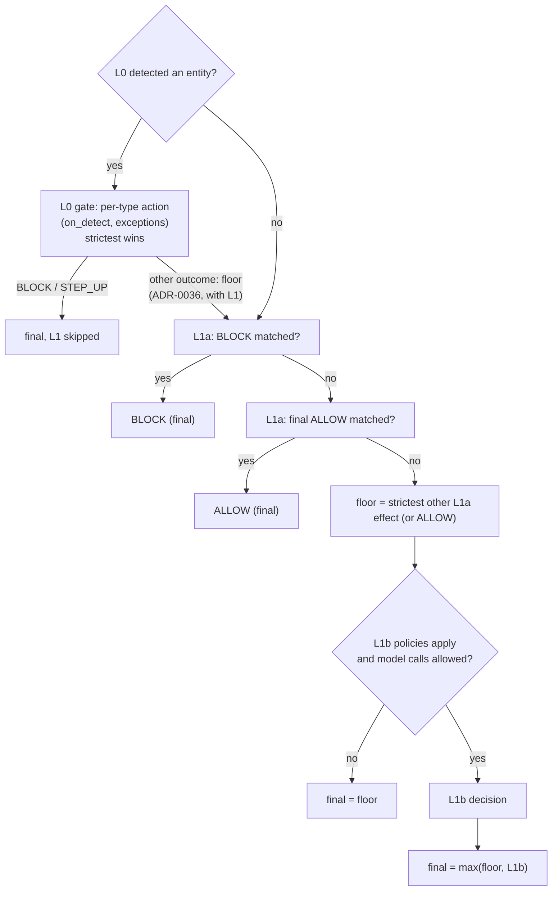

# Decision merge, budgets and failure behaviour

This document is normative: the pipeline's merge function implements exactly these rules,
and its tests enumerate them. The runtime decision is final when L1 finishes
([ADR-0010](../adr/0010-l2-asynchronous-review.md)); L2 does not appear here.

## Actions and restrictiveness

From most to least restrictive:

| Rank | Action | `allowed` |
|---|---|---|
| 5 | `BLOCK` | false |
| 4 | `STEP_UP_APPROVAL` | false |
| 3 | `ALLOW_WITH_MODIFICATIONS` | true |
| 2 | `ALLOW_WITH_WARNINGS` | true |
| 1 | `ALLOW` | true |

Severities: `LOW` < `MEDIUM` < `HIGH` < `CRITICAL`. The response severity is the severity of
the winning outcome; ties between outcomes of equal rank pick the higher severity.

`ALLOW_WITH_MODIFICATIONS` comes from the L0 gate (`on_detect` / exception action) or an
L1a/L1b mapping with `redact: [types]`; the response then carries `output_modifications` with
the scanned text masked for exactly those types.

## Precedence

Rules:

0. **L0 gate** ([ADR-0014](../adr/0014-l0-detection-is-terminal.md)): if L0 detected any entity,
   each detected type gets its `on_detect` action unless the first matching exception covering
   it relaxes it; the strictest action wins, `decided_by: L0`. A `BLOCK` or `STEP_UP_APPROVAL`
   is final and L1a/L1b do not run. Any other outcome (`ALLOW_WITH_MODIFICATIONS`,
   `ALLOW_WITH_WARNINGS`, an exception's `ALLOW`) is a **floor**: L1 runs on the masked text and
   `final = max(L0 outcome, L1 outcome)` ([ADR-0036](../adr/0036-checks-continue-after-masking.md)).
   In effect since L1b (ADR-0040); a masking outcome keeps its masking unless L1 refuses.
   `STEP_UP_APPROVAL` behaves as `BLOCK` in phases without a user interface.
1. An L1a `BLOCK` is final; L1b does not run.
2. An L1a `ALLOW` with `final: true` is final unless rule 1 applies.
3. The **floor** is the strictest non-final L1a effect. L1b can only make the decision
   stricter than the floor.
4. `final = max(floor, L1b)`.
5. Guardrail mode `MONITOR`: the computed decision is recorded as `would_have` and the
   returned action is `ALLOW` (`allowed: true`). This is the definition of the mode, not a
   failure path.
6. The decision event is emitted after the response is computed; emitting never changes or
   delays the decision.

## Budgets (runtime)

| Component | Budget | Source of value |
|---|---|---|
| Whole evaluation | `request.timeout_ms` (default 1 500 ms), capped by settings | request |
| L0 | p95 < 20 ms pattern-only (hypothesis) | measured in F1 |
| L1a | < 5 ms | measured in F2 |
| L1b decision-model call | `l1b.timeout_ms` (default 600 ms) | bundle |

The pipeline tracks the remaining budget. A layer is not started, and a fallback provider
not tried, if its timeout exceeds the remaining budget; the failure rule applies instead.

## Failure behaviour (runtime)

| Failure | Behaviour | Configured by |
|---|---|---|
| Bundle missing / invalid / bad signature | `BLOCK`, error `CONFIG_MISSING` / `CONFIG_INVALID` | fixed |
| L0 exception | `on_evaluation_failure` | bundle (default `fail_closed`) |
| L1a exception | `on_evaluation_failure` | bundle |
| L1b provider error / timeout | try `fallback_provider` if budget allows, else `on_evaluation_failure` applied **to the L1b part**: `final = max(floor, failure action)` | bundle |
| L1b answer outside declared options | treated as provider error | fixed |
| L1b refusal on a question | not an error: the question has no answer; `decide` rules using it do not match; event is marked for review | fixed |
| L1b provider not configured | as a provider error (`L1B_UNAVAILABLE`), never an allow | fixed |
| Shadow policy (any outcome or failure) | logged only; never changes the decision or adds latency when no policy enforces | bundle (`enforcement`) |
| `flags.allow_model_calls = false` | L1b skipped; `final = floor`; `degraded: true` if an L1b policy applied | request |
| Event emit failure | decision unaffected; retried locally and counted | fixed |

`on_evaluation_failure` values (inherited from the UMAI SLO contract):

| Value | Behaviour |
|---|---|
| `fail_closed` (default) | `BLOCK`, reason `EVALUATION_UNAVAILABLE` |
| `fail_open` | `ALLOW`, `degraded: true`, counted separately |
| `step_up` | `STEP_UP_APPROVAL`; behaves as `fail_closed` in phases without a user interface (`TOOL_*`, `MCP_*`, `MEMORY_WRITE`) |

Every degraded or failed path sets `degraded: true` and adds an `errors[]` entry with
`layer`, `type` and `retryable`. There is no unrecorded fail-open. L2 is never a fallback for
runtime failures, and L2 failures never affect runtime decisions.

## Metrics the pipeline must emit

- Decisions by action, deciding layer, guardrail, policy.
- Latency histogram per layer and total.
- L1b provider errors, fallbacks, refusals; review rate.
- Degraded decisions by failure type.

Tenant ids appear only on counters, never on histograms (cardinality).
