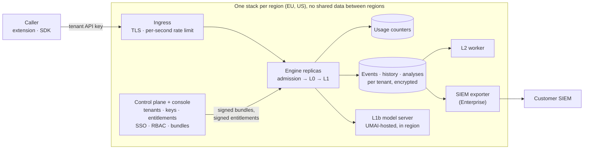
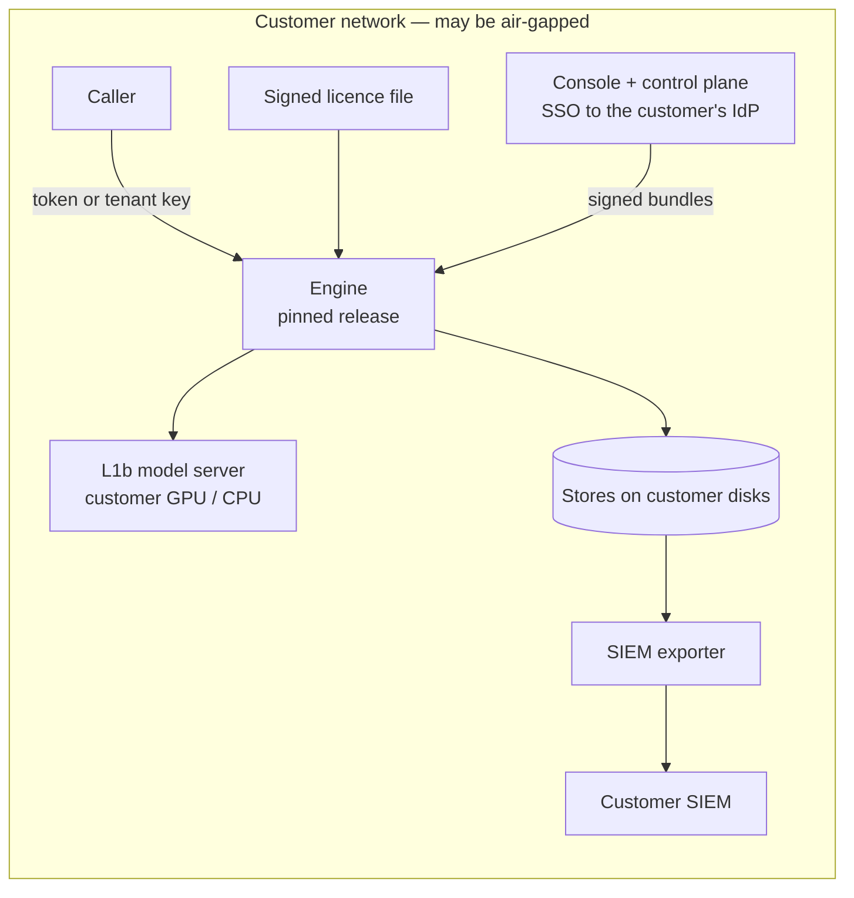

# Deployment modes and editions

**Status:** product target accepted ([ADR-0018](../adr/0018-saas-and-self-hosted-editions.md));
enforcement design proposed ([ADR-0019](../adr/0019-editions-as-runtime-entitlements.md)).
Nothing below is built yet unless the status column says so. Roadmap phase: F6.
Security and tenancy design for the SaaS rows: [`../security/`](../security/) (threat model, gap
analysis, launch plan) and ADR-0023 to ADR-0030.

UMAI is one product with two **deployment modes** (UMAI Cloud SaaS, self-hosted) and two
**editions** (Community, Enterprise). The same release runs everywhere; an edition is a set of
**entitlements** (limits and features) loaded as data.

| | Community | Enterprise |
|---|---|---|
| UMAI Cloud (SaaS) | ✓ (EU region) | ✓ (EU or US region) |
| Self-hosted | — | ✓ |

## Feature matrix: who builds each row

Status: **exists**, **partial**, **missing**, **company** (not code).

| Capability | Community | Enterprise | Lives in | What has to exist | Status |
|---|---|---|---|---|---|
| Requests included | 10 000 / month | Flexible | engine | Per-tenant usage counter, HTTP 429 at the limit, usage endpoint for the console | missing |
| Maximum prompt size | 32 000 characters | Configurable | engine | Size measurement over all request content, HTTP 413 above the limit, deployment-wide cap | deployment-wide cap done (`UMAI_DE_MAX_INPUT_CHARS`, evaluation API 0.9); per-tenant value from entitlements open |
| Hosting | SaaS | SaaS or self-hosted | ops + engine | SaaS: multi-tenant engine, regional stacks. Self-hosted: signed release, packaging, licence | partial (single-tenant engine runs on one server with directory bundles) |
| Support | Community | Enterprise-level | company | Community forum / docs; support process and SLA | company |
| API | ✓ | ✓ | engine | `POST /v1/evaluate` with per-tenant keys | partial (one shared token, ADR-0016) |
| Dashboards | ✓ | ✓ | console + engine | Console pages over decision events, usage, bundle status | partial (console playground and bundle pages) |
| Reports | ✓ | ✓ | console + engine | Periodic summaries over decision events and L2 findings, export | missing (needs F3 event store) |
| SSO | — | ✓ | console | OIDC / SAML login to the console, gated by the `sso` entitlement | missing |
| Role-based access control | — | ✓ | console + engine | Console roles (Lakera: User, Admin, No access; ours adds policy editor and approver for ADR-0013's four-eyes publish); engine key scopes | missing |
| SIEM integration | — | ✓ | engine | Exporter delivering decision and audit events to the customer's SIEM, gated by `siem` | missing (needs F3 events) |
| Version pinning | — | Self-hosted only | release + engine | Immutable signed images, `GET /v1/version`, engine version on every decision event | missing |
| Encryption in transit and at rest | ✓ | ✓ | ops + engine | TLS on every hop; encrypted volumes and KMS-held keys for stores | missing |
| SOC 2, GDPR compliant | ✓ | ✓ | company + engine | Audit program and processing terms (company); controls and evidence (engine) | partial (controls: no raw PII beyond L0, bundle hash on every decision) |
| Data residency | EU | EU / US | ops + engine | One stack per region; region check on tenants; provider regions checked at bundle load | missing |
| AI gateway (ADR-0034) | Entitlement `gateway` | Entitlement `gateway` | engine + console | OpenAI-compatible gateway with guardrails in and out, routes per tenant, usage per route ([gateway-api](../contracts/gateway-api.md)); which editions include it is a product decision | missing (contract 0.1 drafted) |

Policy-bundle version pinning (`bundle.version` in the request) already exists in every
edition. It is a different feature from the version pinning above, which pins the **engine
release**.

## UMAI Cloud (SaaS)



- A tenant belongs to one region. API hostnames are per region (as Lakera's `eu.api…` /
  `us.api…`); there is no global endpoint that forwards content between regions.
- The control plane (console, tenant registry, key issuance, bundle signing) runs per region
  too, so tenant configuration also stays in the region.
- SaaS runs one current release for all tenants (no engine version pinning).

## Self-hosted



- Nothing calls UMAI at runtime: no licence server, no telemetry, no usage upload. Usage is
  available locally (`GET /v1/usage`) and as an exportable report for contract true-ups.
- The customer chooses when to upgrade; each release is an immutable, signed image.
- Who signs bundles on-prem and where the control plane runs are open (Q17, Q18).

## What differs by mode

| Concern | UMAI Cloud (SaaS) | Self-hosted |
|---|---|---|
| Tenants per deployment | Many | One (normally) |
| Caller credential | Per-tenant API keys | Shared token (ADR-0016) or per-tenant keys |
| Entitlements source | Signed snapshots from the tenant registry, hot reload | Signed licence file, hot reload |
| Bundle source | `http_pull` from the regional control plane | `directory` or `http_pull` from the customer's control plane |
| L1b / L2 models | UMAI-hosted in the region; hosted vendors only where they process in the region | Customer hardware; hosted vendors only if the customer allows |
| Upgrades | UMAI continuous delivery | Customer-controlled, pinned |
| Observability | UMAI's monitoring (no content, tenant ids on counters only) | Customer's Prometheus / log stack |
| Encryption at rest | Key Vault-managed keys (customer-managed key on Postgres, envelope-wrapped tenant keys) and encrypted volumes (ADR-0031) | Customer's responsibility, with a hardening guide |

## Admission: what happens before the pipeline

Every `POST /v1/evaluate` goes through admission before L0. Each step has an explicit outcome
(AGENTS rule 4); none of them produces a decision.

| Step | Check | Failure |
|---|---|---|
| 1. Authenticate | Credential → tenant, key id, scopes | 401 |
| 2. Tenant | Body `tenant_id` = credential tenant; tenant region = stack region | 403 `tenant_mismatch` / `wrong_region` |
| 3. Entitlements | Tenant has a valid entitlement record (licence valid or within grace) | 403 `no_entitlement`, or configured licence behaviour (Q24) |
| 4. Prompt size | Characters of all request content ≤ `max_input_chars` (ADR-0019 amendment) | 413 `input_too_large` |
| 5. Quota | Monthly count < `monthly_requests` (or no limit) | 429 `quota_exceeded`, `Retry-After` |
| 6. Pipeline | Tenant-owned bundle → L0 → L1 → decision (unchanged) | as today |

Steps 1–5 add latency on every request; their p95 is measured and reported with
`l0-latency` before the design is accepted.

## Entitlements (proposed shape)

Becomes contract `entitlements` 0.1 when implemented; until then this is a sketch.

```yaml
tenant_id: tenant-demo
edition: community            # community | enterprise
deployment: saas              # saas | self_hosted
region: eu                    # eu | us; empty for self-hosted
limits:
  monthly_requests: 10000     # empty = metered, never refused
  max_input_chars: 32000
features: []                  # any of: sso, rbac, siem, version_pinning
valid_from: 2026-10-17
valid_until: null             # set on licences
```

The entitlement record is signed with Ed25519 like a bundle manifest (ADR-0012). Engines
hold only the public key.

## Limits in detail

**Prompt size.** The size of the whole request content (all messages and artifact contents),
independent of which part the bundle's `l0.target` scans, so a caller can predict the
outcome without knowing the bundle. Never truncated. Measured by L0 code (`l0/size.py`),
because only L0 touches raw content; admission sees the number. Token counting method: Q19. Enterprise
limits are per tenant, capped by a deployment-wide maximum chosen from measured L0 latency
(Lakera documents up to 1 MB per request for Enterprise). Lakera does not document what
happens above its Community limit; our 413 is a deliberate choice.

**Request quota.** Counted per tenant per calendar month (UTC) at admission. Rejected 4xx
requests do not count; failure-policy decisions do. Under concurrency the count may overshoot
by the number of in-flight requests across replicas; this is accepted and documented. The
console shows usage and warns at 80 % and 100 %. Counter store for SaaS: Q23.

**Rate limits.** Per-second limits against abuse belong at the SaaS ingress. They are not
part of the edition table (Q27).

## Tenant isolation (SaaS)

- Keys: issued in the console, shown once, stored hashed, revocable; scopes limit what a key
  may call.
- Bundles: the signed manifest names the owning tenant; the store never resolves another
  tenant's bundle.
- Stores: every write takes the tenant from the credential; every read filters by it.
- HMAC keys for entity hashes are per tenant (already the case); in SaaS they are generated per
  tenant and wrapped by Key Vault Premium (ADR-0027 §5, ADR-0031 §3).
- Isolation is tested, not assumed: every tenant-scoped endpoint has a cross-tenant test.

## Data residency and providers

The stack's region is a setting. Each provider registry entry declares the regions where it
processes data. Bundle validation rejects a bundle whose L1b provider, fallback, shadow
providers or L2 model are not permitted in the stack's region. Known constraints today:
TypeSafe Jev is US-hosted ([`reference/typesafe-jev.md`](../reference/typesafe-jev.md)); OpenAI
offers EU regional processing ([`reference/openai-decisions-api.md`](../reference/openai-decisions-api.md));
the legal basis for even redacted text is Q4. Which providers Community may use is Q26.

## SIEM export

- Records: decision events ([tagged-action](../contracts/tagged-action.md); no raw content by
  construction) and audit events (keys issued or revoked, bundle activated or rolled back,
  entitlement or licence changes, console sign-ins).
- Delivery: an asynchronous exporter off the request path, at-least-once, idempotent by
  event id, per-tenant destinations and credentials, with a dead-letter record on repeated
  failure.
- Targets and wire format (e.g. Splunk HEC, Microsoft Sentinel, IBM QRadar, syslog CEF,
  signed webhooks, OCSF): Q22. Lakera's only mechanism is JSON-lines files in an
  S3-compatible bucket ([reference](../reference/lakera-guard.md)), which is a cheap first target on other clouds; on
  Azure the first targets are immutable Blob Storage (JSON lines) and Event Hubs → Sentinel
  (ADR-0030 §5, ADR-0031 §8).
- The leak suite runs over export payloads.

## Version pinning and releases

- Every release is an immutable container image with a semantic version, signed, with a
  software bill of materials.
- `GET /v1/version` reports engine version, L0 catalog version and the model id of every
  configured provider. Every decision event records the engine version, so a decision is
  traceable to bundle hash **and** engine release.
- Self-hosted customers pin a release and upgrade on their own schedule; SaaS runs the
  current release.

## Encryption

- **In transit:** TLS 1.2 or later on every hop. SaaS terminates at the regional ingress and
  uses TLS internally; self-hosted engines can serve TLS themselves or sit behind the
  customer's proxy. Provider calls are HTTPS only, with certificate verification.
- **At rest:** event, history, analysis, usage and bundle-cache stores on encrypted volumes;
  in SaaS with Key Vault-managed keys (ADR-0031). Tenant HMAC keys and signing keys never sit
  in plain files.

## Compliance: what the code provides

SOC 2 and GDPR compliance are properties of how UMAI operates, verified by audits and
contracts, not features of a binary. KVKK applies as well for Turkish customers. The engine
supplies controls and evidence:

| Control | Engine mechanism | Status |
|---|---|---|
| Data minimisation | Raw PII never leaves L0 (ADR-0005); logs never carry content | exists |
| Traceability | Bundle id, version, hash on every decision; engine version (planned) | partial |
| Access control | Per-tenant keys, scopes, console RBAC | missing |
| Audit trail | Audit events for configuration and access changes | missing |
| Retention and erasure | Per-tenant retention settings and deletion for stores | missing |
| Encryption | See above | missing |
| Sub-processors | Provider registry lists every external processor per region | missing |

For self-hosted installs the customer operates the system; UMAI's SOC 2 scope covers UMAI's
development process and the SaaS, not the customer's infrastructure.

## Planned contract changes

Not yet in [`../contracts/`](../contracts/); each lands with its code (skill `change-contract`).

| Contract | Change |
|---|---|
| evaluation-api → 0.5 | 403 / 413 / 429 error bodies; `GET /v1/usage`, `GET /v1/entitlements`, `GET /v1/version`; per-tenant keys and scopes |
| policy-bundle | Manifest names the owning tenant |
| tagged-action | `engine_version` |
| gateway-api 0.1 (new, drafted) | OpenAI Chat Completions surface, routes, refusals, streaming (ADR-0034) |
| evaluation-api (gateway WP2) | Per-message masks, scan of every forwarded message, one placeholder namespace per call |
| credentials (gateway WP2) | `gateway` scope |
| entitlements 0.1 (new) | Entitlement record and licence file |
| siem-export 0.1 (new) | Export envelope for decision and audit events |
| audit-event 0.1 (new) | Configuration and access events |

## Open questions

Q19 token counting · Q20 over-quota behaviour · Q21 Türkiye region · Q22 SIEM targets ·
Q23 counter store · Q24 licence expiry · Q25 compliance programs · Q26 Community providers ·
Q27 rate limits — see [`../open-questions.md`](../open-questions.md). Also Q17 and Q18, which
self-hosted Enterprise now depends on.
