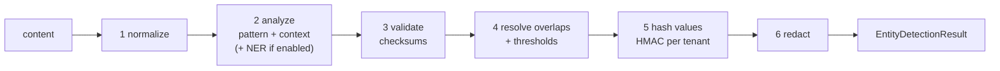
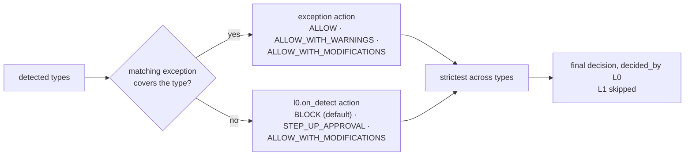

# L0 — Entity detection

**Question:** what sensitive entities are in this content?
**Technology:** Presidio analyzer (pinned `2.2.364`; project now at
`data-privacy-stack/presidio`, MIT) with **our own** Turkish recognizers, validators,
context scoring, hashing and redaction. Library facts and pitfalls:
[`../reference/presidio.md`](../reference/presidio.md).
**Contract:** [`../contracts/entity-detection.md`](../contracts/entity-detection.md).

## Responsibilities

- Detect, validate and score entities in the evaluated content.
- Produce the redacted view and per-entity HMAC hashes.
- **Decide when it detects something (the L0 gate).** A detection is terminal: the action
  comes from `l0.on_detect` per entity type (default `BLOCK`), deterministic exceptions may
  relax it, and **L1 does not run** — no decision-model call, no tokens
  ([ADR-0014](../adr/0014-l0-detection-is-terminal.md)). With no detection, the input goes
  to L1.

L0 is the only layer that holds raw content. Everything it returns is safe to pass on.

## Internal steps



1. **Normalize** a working copy for matching, keeping an offset map back to the original:
   - Unicode NFKC (full-width digits, compatibility characters).
   - Strip zero-width and bidi control characters (`U+200B–U+200F`, `U+202A–U+202E`,
     `U+2060–U+2064`, `U+FEFF`). These are a known evasion technique.
   - Do **not** lowercase with `str.lower()` for Turkish matching: `"İ".lower()` yields
     `"i̇"` (two code points) and `"I".lower()` yields `"i"` instead of `"ı"`. Use
     case-insensitive regex flags or a Turkish-aware casefold helper.
   - Digit groups separated by spaces, dots or dashes (`123 456 789 01`) must still match
     ID patterns; recognizers handle separators, normalization does not remove them.
   - Two digit-evasion tricks are undone (measured in the `l0-pii-tr` eval): 7+ digits written
     one by one with a separator (`1 0 0 0 0 0 0 0 1 4 6`) are joined, and `O`/`o` inside a
     long digit run (`1OOOOOOO146`) becomes `0`. Offsets still map to the original text.
   - NFC as well as NFKC: NFD input (`s` + U+0327) breaks Turkish-letter matches.
   - Patterns use `[0-9]`, never `\d` (Python `\d` matches Arabic-Indic and full-width digits).
2. **Analyze** with a Presidio `AnalyzerEngine` built from a **minimal registry** of our
   recognizers, registered for both `tr` and `en` (Presidio gating is exact and it does no
   language detection), with the **`no_op` NLP engine** (no spaCy pipeline per call).
   Never the default `AnalyzerEngine()` (it loads `en_core_web_lg`). Every catalog type is a
   Presidio `LocalRecognizer` (`SpecRecognizer`) in that registry; the bundle's
   `l0.custom_recognizers` run through the same class, per request. Patterns marked
   `requires_context` (shapes that collide with ordinary numbers: VKN, BSN, PESEL, DE tax ID,
   compact SSN, national-format phones, plates, generic AWS secrets) are dropped before
   validation when none of their context words is in the window. NER recognizers
   (`HuggingFaceNerRecognizer`) are added only when `l0.ner.enabled` (ADR-0020, Q8).
3. **Validate**: checksum-bearing entities (IBAN, card, VKN) are dropped when the
   checksum fails; a TCKN-shaped number that fails the checksum is kept unvalidated at a low
   score so that only explicit ID context lifts it over `min_score` (a mistyped or made-up ID
   next to "kimlik" is still an attempt to share one). This is the main precision gain over the old regex rules. A weak
   checksum (VKN and Luhn, ~10 % random pass rate) keeps the low pattern score so that
   context must lift it; a strong one (TCKN, TR IBAN, ~1 %) raises it. Known non-PII values
   (`11111111111` GİB placeholder, `1234567890`) are dropped.
4. **Score context** with our Turkish-aware context step (see below), then **resolve
   overlaps and thresholds**: prefer validated hits (checksum, or structure for secrets and
   links), then the higher type priority, then the longer span, then the higher score
   (Presidio only de-duplicates same-type containment); drop results below `l0.min_score`
   (per entity type override allowed); drop `UNKNOWN_LINK` hits whose domain is in
   `l0.allowed_domains`.
5. **Hash**: `HMAC-SHA256(tenant_key, canonical_value)` truncated to 16 bytes, hex. The
   canonical value strips separators (`TR12 0006 …` → `TR120006…`). Hashes let L1/L2 count
   "the same TCKN appeared in 7 actions this session" without storing the value. Tenant key
   comes from settings, never from the bundle.
6. **Redact**: replace each entity with `<TYPE_n>`, numbered per type in order of first
   appearance; the same value gets the same placeholder within one evaluation.

## L0 gate (ADR-0014)

Runs right after detection when at least one entity survived thresholds.



| Rule | Detail |
|---|---|
| Default | Every detected type → `l0.on_detect.default` (`BLOCK`) unless `on_detect.actions` names it |
| Never plain ALLOW | `on_detect` accepts only `BLOCK`, `STEP_UP_APPROVAL`, `ALLOW_WITH_MODIFICATIONS`; `ALLOW` / `ALLOW_WITH_WARNINGS` are rejected at bundle load |
| Masking | `ALLOW_WITH_MODIFICATIONS` returns `output_modifications.redacted_text`: the scanned text with exactly the masked types replaced (`<TR_PHONE_1>`) |
| Exceptions | `l0.exceptions[]`: `when` (L1a condition language over facts: subject, destination, phase, agent action, entity counts), `entities` (empty = all), `action`. First matching exception per type wins. Missing facts never match |
| Strictest wins | `BLOCK` > `STEP_UP_APPROVAL` > `ALLOW_WITH_MODIFICATIONS` > `ALLOW_WITH_WARNINGS` > `ALLOW` |
| No UI | `STEP_UP_APPROVAL` in `TOOL_*`, `MCP_*`, `MEMORY_WRITE` behaves as `BLOCK` |
| Reason | Types and exception ids only: `L0: TR_TCKN, CREDIT_CARD detected`, `L0: TR_TCKN allowed by exception ex-kyc-internal` |
| Cost | Rule evaluation only; included in the L0 latency |

```yaml
l0:
  on_detect:
    default: BLOCK
    actions: { EMAIL_ADDRESS: ALLOW_WITH_MODIFICATIONS, TR_PHONE: ALLOW_WITH_MODIFICATIONS }
  exceptions:
    - id: ex-kyc-internal
      when: { all: [ { field: subject.department, operator: EQUALS, value: KYC },
                     { field: destination.class, operator: EQUALS, value: internal_app } ] }
      entities: [TR_TCKN]
      action: ALLOW
```

## Entity catalogue

The target and status of every type is in [`l0-entity-catalog.md`](l0-entity-catalog.md)
(ADR-0017: Lakera parity, Türkiye, Europe, secrets — 27 types, all implemented; `PERSON` via
a gazetteer until NER, ADR-0020). The table below details the core Turkish types.

| Entity type | Detection | Validation | Default |
|---|---|---|---|
| `TR_TCKN` | 11 digits, first ≠ 0, separators allowed; `(?<![0-9])…(?![0-9])` boundaries, not `\b` (must match `10000000146dır`) | TCKN checksum. A checksum failure is kept as `validated: false` with score 0.2, so it is caught **only with ID context** (`kimlik no`, `TC`, `kimlik nom` → 0.5); placeholders with ≤ 2 distinct digits are dropped | on |
| `TR_VKN` | 10 digits, low base score | VKN checksum + **context required** | on |
| `TR_IBAN` | `TR` + 24 chars (`TR\d{2}\d{5}0[0-9A-Z]{16}`), spaces allowed | ISO 7064 mod 97-10 | on |
| `IBAN_CODE` | Presidio `IbanRecognizer` (other countries) | mod-97 | on |
| `TR_PHONE` | `+90` / `0090` / `90` / `0` / bare 10 digits; mobile, fixed, VoIP, toll-free ranges from libphonenumber | number-type plausibility. A valid **mobile** number scores 0.6 even bare and without context (`5321234567`); bare fixed-line numbers need context (they collide with reference numbers) | on |
| `CREDIT_CARD` | own patterns incl. **TROY `9792`** and **Mastercard 2-series** (Presidio's regex misses both) | Luhn + IIN or context | on |
| `EMAIL_ADDRESS` | Presidio built-in | — | on |
| `TR_PLATE` | case-sensitive regex from the reference doc (Presidio's matches `12 eki 2024` with score 1.0) | province code range; **context required** | per bundle |
| other catalog types | see [`l0-entity-catalog.md`](l0-entity-catalog.md) | | per bundle |
| tenant custom (`CUSTOMER_NO`, …) | `l0.custom_recognizers` (policy-bundle 0.5) | optional built-in validator | per bundle |

Algorithms and synthetic test vectors: [`../reference/turkish-identifiers.md`](../reference/turkish-identifiers.md).
Checksum code is ours (python-stdnum is LGPL).

**Why our own recognizers instead of Presidio's Turkish ones** (`TR_NATIONAL_ID`,
`TR_LICENSE_PLATE`, `TR_PHONE_NUMBER`, all disabled by default upstream): `\b` boundary
misses on suffixed Turkish words, score-1.0 plate false positives, no VKN, multi-word
context that never matches. Our entity names stay as above; the mapping to Presidio names
is in the reference doc so upstream fixes can be adopted later.
Adding a type: skill `add-pii-recognizer`; the type must also be added to
[`../contracts/tag-taxonomy.md`](../contracts/tag-taxonomy.md).

## Context scoring

Context words raise a pattern match's score when supporting words appear nearby. Presidio's
`LemmaContextAwareEnhancer` does not work for Turkish: `str.lower()` breaks İ/I, multi-word
entries never match text, Turkish suffixes (`kimliğim`, `numaram`) defeat matching without
lemmas, and the `no_op` engine provides no tokens at all
([issue #2216](https://github.com/data-privacy-stack/presidio/issues/2216)).

L0 therefore runs its own context step after analysis:

- a window of N words before **and after** the match (default 6 / 3);
- Turkish-aware case folding (`İ→i`, `I→ı`) on the window only, so offsets do not change;
- prefix matching, so `kimlik` matches `kimliğim`; phrase entries (`tc kimlik`,
  `vergi no`) match across adjacent words;
- Turkish and English context lists per recognizer (examples: `tc`, `kimlik`, `tckn`,
  `nüfus` for TCKN; `iban`, `hesap`, `eft`, `havale` for IBAN; `vergi`, `vkn` for VKN).

Alternative to benchmark in F1: Presidio `slim` engine with a blank Turkish pipeline and
lookup lemmatizer (`spacy-lookups-data`), plus the upstream case-folding fix when PR #2208
lands.

A bundle enables exactly the types it lists in `l0.entities`; nothing is on by default
in code (AGENTS.md rule 8).

## Performance plan

| Item | Plan |
|---|---|
| Startup | Build `AnalyzerEngine` once per process from the minimal registry; warm up with a synthetic sample (recognizers lazy-load on first call). |
| Entity scope | The registry holds only our recognizers; `entities=[...]` alone does **not** skip NLP work. |
| NLP engine | `no_op` for the pattern path. |
| NER | Off by default. If enabled: `HuggingFaceNerRecognizer`, ideally run only when patterns or policy require it; budget 30–80 ms (hypothesis). |
| Pattern-only budget | p95 < 20 ms for a 4 kB input. Measured 2026-10-17 (dev machine, one thread, all 27 types): business text 4 kB p95 11 ms, 16 kB p95 41 ms; entity-dense text (≈160 entities per 4 kB) 4 kB p95 25 ms. The six core types alone: 4 kB p95 6 ms (business) / 16 ms (dense). Cost drivers were libphonenumber parsing of national-format candidates and per-candidate context scoring — fixed by `requires_context` and cached context windows. |
| Long inputs | Inputs above `l0.max_chars` are chunked with overlap; offsets are re-based. |
| Concurrency | `analyze()` is synchronous and CPU-bound, thread-safety undocumented: process pool or one engine per worker thread, never on the event loop. |
| Regex safety | `REGEX_TIMEOUT_SECONDS=1` (integer only). Tenant regexes are validated at bundle load. |
| Offline | No runtime model downloads: models vendored in the image, `HF_HUB_OFFLINE=1` (required for on-prem). |
| Logging | `log_decision_process=False`; `presidio-analyzer` logger at INFO or above (DEBUG prints context words). |

## Configuration (`l0` block of the policy bundle)

```yaml
l0:
  entities: [TR_TCKN, TR_IBAN, IBAN_CODE, TR_PHONE, CREDIT_CARD, EMAIL_ADDRESS]   # core scope
  min_score: 0.5
  min_score_overrides: { TR_PHONE: 0.6 }
  ner: { enabled: false }
  custom_recognizers: []          # customer-defined types (policy-bundle 0.5)
  allowed_domains: []             # UNKNOWN_LINK: trusted domains of this guardrail
  max_chars: 32000
```

Full schema: [`../contracts/policy-bundle.md`](../contracts/policy-bundle.md).

## Testing requirements

- Each recognizer: valid vectors, invalid-checksum vectors, separator variants, Turkish
  and English context, and a false-positive set (order numbers, phone-like timestamps).
- Redaction: placeholder numbering, same-value consistency, offsets after normalization.
- A leak test: serialize the whole `EntityDetectionResult` (including `redacted_text`)
  and assert that no detected raw value, with or without separators, appears in it.
