# Architecture overview

## Purpose

Given one AI interaction event (a prompt, a model output, a tool call, an MCP request, a
memory write) and the policy bundle that applies to it, return a decision quickly enough
to sit inline in front of the AI system:
`ALLOW`, `ALLOW_WITH_MODIFICATIONS`, `ALLOW_WITH_WARNINGS`, `STEP_UP_APPROVAL` or `BLOCK`.
Afterwards, review selected decisions in the context of their session and raise findings.

## Principles

1. **The runtime decides, once.** The decision is final when the L0 gate or L1 finishes; the
   caller never waits for L2 and L2 never changes it. ([ADR-0010](../adr/0010-l2-asynchronous-review.md))
2. **Layers enrich, they don't re-read.** L1 reasons over L0's entities as facts; L2
   reasons over L1's decision events.
3. **An L0 block is terminal; masking is a floor.** If L0 finds an entity, the L0 gate decides
   per type (default `BLOCK`, deterministic exceptions). A `BLOCK` ends the evaluation — no
   decision-model tokens on input that is already decided. A masking or exception outcome
   continues to L1 on the masked text, which can only make it stricter, so attack and
   agent-action checks cannot be skipped by adding an entity.
   ([ADR-0014](../adr/0014-l0-detection-is-terminal.md), [ADR-0036](../adr/0036-checks-continue-after-masking.md))
4. **Raw PII stays in L0** (and in the gateway forwarder, which sends it only to the caller and
   the route's upstream). Models, logs, events and stores see redacted text and entity
   metadata. ([ADR-0005](../adr/0005-no-raw-pii-beyond-l0.md), [ADR-0035](../adr/0035-raw-content-zone-l0-and-gateway.md))
5. **Cheap and certain first.** Deterministic rules run before the decision model; a
   certain answer ends the evaluation early.
6. **Models classify, code authorizes.** Thresholds, precedence and enforcement are code.
7. **On-prem first.** Every runtime component, including the decision model, must run on
   a customer's own server. ([ADR-0004](../adr/0004-decision-model-provider-abstraction.md))
8. **One release, every edition.** The same engine runs as multi-tenant SaaS and as a
   self-hosted install, in Community and Enterprise editions; limits and features are
   entitlements loaded as data. ([ADR-0018](../adr/0018-saas-and-self-hosted-editions.md),
   [deployment and editions](deployment-and-editions.md))

## Flow

```mermaid
flowchart LR
    SRC["Caller<br/>browser extension · Agent SDK"] --> L0

    subgraph RUNTIME["Runtime (synchronous) — umai-decision-engine API"]
        L0["<b>L0 — Entity detection</b><br/>Presidio + Turkish recognizers<br/>entities · hashes · redacted view"]
        L0 -->|"entity detected"| GATE["<b>L0 gate</b><br/>on_detect per type (default BLOCK)<br/>+ deterministic exceptions"]
        GATE -->|"BLOCK: L1 skipped"| DEC
        GATE -->|"masked: floor (ADR-0036)"| L1A
        L0 -->|"nothing detected"| L1A["<b>L1a — Deterministic rules</b><br/>facts: role, destination,<br/>phase, agent action"]
        L1A -->|"certain outcome"| DEC
        L1A -->|"needs judgement"| L1B["<b>L1b — Decision model</b><br/>on-prem, Jev-compatible API<br/>policy → typed questions"]
        L1B --> DEC["<b>Final decision</b><br/>+ tags + evidence"]
    end

    DEC -->|"response"| SRC
    DEC --> EVT["Decision event<br/>(tagged action)"]
    EVT -->|"review_when matches"| Q[("Durable event delivery<br/>at-least-once, idempotent")]
    EVT --> HIST[("Session history")]

    subgraph REVIEW["Asynchronous review — L2 worker"]
        Q --> L2["<b>L2 — LLM analyst</b><br/>gpt-oss-safeguard<br/>event + session history + policy"]
        HIST --> L2
    end

    L2 --> AN["Analysis record"]
    AN -->|"above threshold"| FIND["Finding candidate<br/>→ operator review"]
```



### One evaluation, step by step

```mermaid
sequenceDiagram
    autonumber
    participant C as Caller
    participant P as Pipeline
    participant L0 as L0
    participant L1 as L1a + L1b
    participant S as Event sink
    participant W as L2 worker

    C->>P: EvaluationRequest
    P->>L0: content
    L0-->>P: entities, redacted view
    alt entity detected
        P->>P: L0 gate: on_detect + exceptions (no model call)
        P-->>C: EvaluationResponse (decided_by L0)
    end
    P->>L1: facts + excerpt (only when nothing was detected)
    L1-->>P: decision, tags, probabilities, review flag
    P-->>C: EvaluationResponse (final)
    P-)S: decision event (always to history; to review queue if selected)
    S-)W: deliver selected event (at-least-once)
    W->>W: load session history, call L2, validate analysis
    W-)S: analysis (+ finding candidate)
```

## What each component sees

| Data | L0 | L1a | L1b provider | Decision event / history | L2 provider | Logs / metrics |
|---|---|---|---|---|---|---|
| Raw content | yes | no | **no** | **no** | **no** | **no** |
| Redacted content | produces | yes | trimmed excerpt | short excerpt | excerpts | no |
| Entity types, counts | produces | yes | yes | yes | yes | types and counts |
| Entity value hashes | produces | yes | no | yes | no (only "seen N times") | no |
| Subject / destination / phase | yes | yes | role, department, class | yes | role, department, class | ids only |

## Latency and throughput

| Path | Components | Measure | Target |
|---|---|---|---|
| Runtime | L0 (+ gate) or L0 + L1a + L1b | p50 / p95 / p99 from request accepted to decision written | Hypothesis p95 ≤ 400 ms; not a commitment until measured on the reference on-prem hardware |
| Review | queue + history read + L2 | queue age, processing time, failure and redelivery rates | Set in F3 from measurements |

The `umai-engine` SLO figures (deterministic p95 ≤ 400 ms; LLM path p95 ≤ 2 500 ms) are not
carried over as commitments; see [`../platform-context/umai-engine-today.md`](../platform-context/umai-engine-today.md).

## Layer documents

- [L0 — entity detection](l0-entity-detection.md)
- [L1 — policy decision](l1-policy-decision.md)
- [L2 — asynchronous LLM review](l2-llm-analyst.md)
- [Decision merge and failure](decision-merge-and-failure.md)
- [Deployment modes and editions](deployment-and-editions.md)
- [Code layout](code-layout.md)

## Relationship to `umai-engine`

None at runtime: this is a separate project. Background: `umai-engine` runs preflight regex
→ AGT rules → heuristic and context-aware (LLM) policies in parallel → most restrictive wins,
all synchronous. This engine is designed so it could replace it (L0 + L1 at runtime, the LLM
judge moved to asynchronous review). Details: [`../platform-context/`](../platform-context/).
