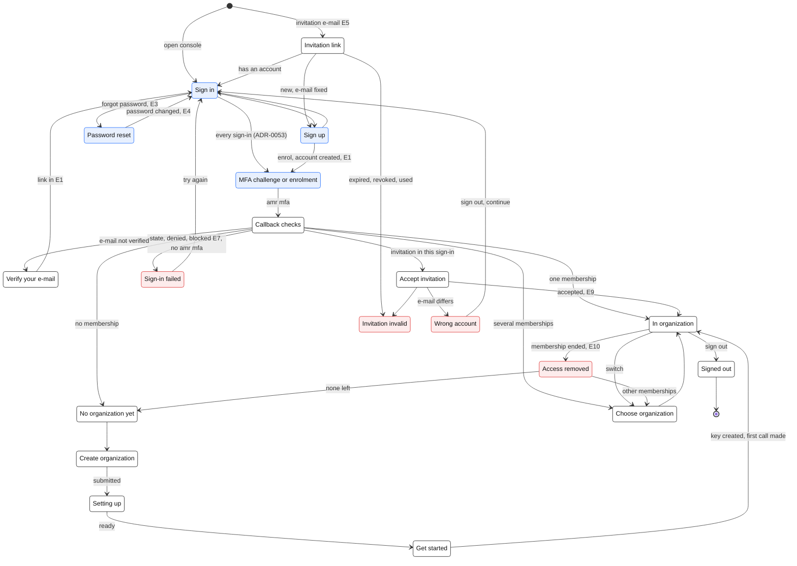

# Sign-in and onboarding

**Status:** design approved by the product owner (Pass 1), 2026-10-18; open points in §11. Nothing here is built unless a line says
so. Decisions: [ADR-0033](../adr/0033-organizations-and-onboarding.md) (organization model) and
[ADR-0024](../adr/0024-human-identity-oidc-keycloak.md) (identity service). Vendor facts:
[`reference/identity-providers.md`](../reference/identity-providers.md), section "Sign-in,
onboarding and branding" (verified 2026-10-18); a fact marked *unverified* there is not relied
on here.

Code lands in two repositories: organizations, memberships, invitations and the identity
broker in the policy service (this repository); pages, design tokens, hosted-page and e-mail
templates, the Keycloak theme and the Auth0 configuration as code in `umai-control-center`.

## 1. Goal and scope

A stranger signs up, creates an organization, invites a colleague and makes a first evaluate
call with the organization's own key, without help, in Turkish or English, on pages and
e-mails that look like UMAI. Measured as **time from sign-up to the first successful evaluate
call** (§9.7).

In scope: sign-up, e-mail verification, sign-in, password reset, MFA, invitation acceptance,
creating and switching organizations, sign-out, error pages, every e-mail of these flows,
branding, environments, tests.

Not in scope here: enterprise SSO and SCIM (stage 2, ADR-0024 §8); plans, payment and upgrades
(ADR-0028); deleting an organization, data export (ADR-0025 §9); social login (open point 10).

## 2. Ground rules

- **Hosted login only.** Every password, MFA code and recovery code is typed on the identity
  service's own pages (Auth0 Universal Login in UMAI Cloud, Keycloak's login theme
  self-hosted). The console never renders a credential field.
- **Standard OIDC in the console.** Authorization code with PKCE, `ui_locales`, `acr_values`,
  ID-token claims `sub`, `email`, `email_verified`, `amr`, `sid`. The organization is the one
  per-issuer difference, and it is declarative (ADR-0033 §2): Auth0 takes `organization=<org id>`
  and returns `org_id`; Keycloak takes scope `organization:<alias>` and returns an
  `organization` claim map. Two settings, no vendor code. Vendor-specific calls exist only in
  the `IdentityBroker` inside the policy service (ADR-0033 §8).
- **The token proves who and which organization; our store decides membership and roles**
  (ADR-0033 §1, ADR-0029). Removing someone takes effect in our store, whatever the identity
  service still believes.
- **Every failure has a page and a recorded outcome** (AGENTS rule 4): no blank screen, no raw
  identity-service error, a correlation id on every error page, an audit event for every
  refusal that matters (ADR-0030).
- **Two languages, one catalogue.** Turkish and English for every page and e-mail, from one
  message catalogue (§8.6).
- **Synthetic test users only**, also in the five-user study (§9.8).
- **No production Auth0 tenant until Q35 is decided** (§7.4).

## 3. The flow at a glance

Blue: hosted pages (Auth0 or Keycloak). White: console. Red: problem states that have their own
page. `E1`…`E15` are the e-mails of S12 (§4).

## 4. Surfaces

Each surface has an id (`S1`…) used by the test plan and the screenshot set. "Hosted" means the
identity service's page, styled by our tokens (§8); "console" means a page in
`umai-control-center`.

### S1 Sign-up (hosted)

| | |
|---|---|
| Entry | "Create account" on the sign-in page; an invitation link for someone without an account (e-mail fixed to the invited address) |
| Fields | E-mail, password. Nothing else: name and organization come later in the console, so the hosted page stays standard |
| States | Form → submitting → account created → back to the console callback (signed in, e-mail not yet verified) and E1 sent |
| Errors | Invalid e-mail; password below policy (rules shown before typing, checked inline); password found in a breach list (where the plan offers it); account already exists (wording per the identity service, see §11 point 11); too many attempts from one address (attack protection) |
| Notes | Terms are accepted when an organization is created (S7), on behalf of the organization, not on the hosted page. The page footer links to the privacy notice in the page's language |

### S2 E-mail verification (e-mail E1 → hosted result → console gate)

| | |
|---|---|
| Entry | E1 after sign-up; the console's gate page whenever `email_verified` is false |
| Console gate | "Verify your e-mail": the address, **Resend** (at most once a minute and five times an hour, through the broker), **I have verified it** (new sign-in so the token carries the change), **Wrong address? Sign out** |
| States | Waiting → link opened → hosted "e-mail verified" result → back to the console sign-in → callback passes the check |
| Errors | Link expired (Auth0 default lifetime 5 days) or already used (hosted result page, then the console gate offers Resend); resend limit reached (gate says when it can be sent again) |
| To test first | Auth0 tenants created after 2026-05-05 on non-Enterprise plans cannot set the e-mail "Redirect To", so where the hosted result page sends the person next is confirmed in the development tenant before the copy is final (reference) |
| Rule | Nothing beyond the gate (create or join an organization, keys) is possible until the e-mail is verified (ADR-0033 §4) |

### S3 Sign-in (hosted)

| | |
|---|---|
| Entry | Any console URL without a session (`/auth/login?returnTo=…`); the signed-out page |
| Form | Identifier first (e-mail, then password), so that stage 2 can route an e-mail domain to the organization's enterprise connection without redesigning the page. Links: Forgot password, Create account. The language comes from `ui_locales` (§8.6) |
| States | E-mail → password → (MFA challenge, S5) → console callback |
| Errors | Wrong e-mail or password (one generic message); account blocked after repeated failures (E7, unblock link); user blocked by an administrator; the identity service unreachable (the browser cannot reach the page; the status page covers it) |

### S4 Password reset (hosted, e-mails E3 and E4)

| | |
|---|---|
| Entry | "Forgot password" on S3 |
| States | Ask for the e-mail → **always** "If an account exists, we have sent a link" (no account enumeration) → E3 → set a new password (policy shown) → done → sign-in |
| Errors | Link expired or used (request a new one); new password below policy; too many requests |
| After | E4 "your password was changed" (later, S12); the person can end their other console sessions (Sessions, "Sign out other devices"); ending them automatically after a password change comes with the identity mirror (ADR-0024 §2 amendment) |

### S5 MFA (hosted enrolment and challenge)

| | |
|---|---|
| When | **Every person, every console sign-in** (ADR-0053, amending ADR-0024 §3, which named `owner` and `admin`). The console sends `acr_values` for multi-factor on every authorization request and starts no session without `amr` `mfa`; Auth0's policy is *Always*, so a person without a factor enrols at their first sign-in (right after sign-up, or when accepting an invitation) |
| Factors | Authenticator app (TOTP); a recovery code shown once at enrolment and replaced after use; security key or device biometrics (WebAuthn) once the paid plan's tier is confirmed to include them. No e-mail, SMS, voice or push. Auth0's Free plan lists no MFA factors (§11 point 3). Passkeys as a first factor are a later option once the login domain is final (they bind to it); Auth0 still asks for the second factor after one |
| States | Enrol (scan or type the secret → enter a code → recovery code) → challenge at every later sign-in (a post-login Action sets `allowRememberBrowser: false`, so no "remember this browser") → callback |
| Errors | Wrong or reused code; too many attempts; lost device → recovery code; lost device and recovery code → UMAI support resets the person's factors after checking who they are outside the product (another owner of the organization confirms; a sole owner: the contact in the beta agreement). Organization admins cannot reset factors: the account spans all the person's organizations. A token without `amr` `mfa` → `/auth/signed-out?error=mfa` |

### S6 Invitation acceptance (e-mail E5 → console landing → hosted → console)

| | |
|---|---|
| Entry | E5. UMAI Cloud: sent by the policy service (Auth0 ticket created with `send_invitation_email: false`), linking to the console's `/auth/invitation?invitation=<ticket>&organization=<org id>`. Self-hosted: Keycloak's `org-invite` e-mail from our theme |
| Landing (console) | Before redirecting, the console shows organization name, inviter and role, and checks the invitation in our store, so an invalid link fails on our page, in our language, without a trip to the identity service. **Continue** forwards `invitation` and `organization` to the authorization request |
| States | Landing → hosted sign-in or sign-up in the organization's context (the invited address fixed; Auth0 marks it verified on acceptance) → callback → our store accepts (pending, unexpired, e-mail match, ADR-0033 §3.2) → membership → "You joined <organization>" → E9 to the inviter |
| Errors | Expired; revoked; already used; signed in as another account (**Wrong account**: shows both addresses, "Sign out and continue"); verified e-mail differs from the invited one; organization suspended; already a member (treated as success: open the organization) |

### S7 Create organization (console)

| | |
|---|---|
| Entry | "No organization yet" after the first verified sign-in; "Create organization" in the switcher (when the person may own another) |
| Fields | Organization name (2–100 characters); identifier (derived from the name, editable, 3–40 of `a–z 0–9 -`, unique, not reserved; becomes the tenant slug and the identity organization's name); region (select with one option, EU, and the sentence "Your organization's data stays in this region. It cannot be changed later."); acceptance of the customer terms and the data processing terms, with links |
| States | Form → submitting → **Setting up** (steps shown: organization, entitlements, sign-in, starter guardrail) → Get started (S8); MFA is already enrolled at sign-up (S5, ADR-0053) |
| Errors | Identifier taken or reserved; e-mail domain is disposable; Community organization limit reached ("contact us for Enterprise"); terms not accepted; setting up takes longer than 30 s (the page keeps polling; the reconcile job retries; after 5 min it shows a correlation id and the support address) |

### S8 Get started (console)

| | |
|---|---|
| Entry | Right after S7; afterwards from the organization's home until every step is done |
| Steps | 1. **Create API key** (shown once, copy button, "I have stored it" confirmation; ADR-0033 §7). 2. **Send your first request**: curl, Python and JavaScript snippets with the key filled in on screen only, the regional API host and a synthetic sample text. 3. **First call received**: the page watches for the tenant's first evaluation and ticks the step, showing the decision. 4. **Invite your team** (S6). 5. **Open your guardrail** |
| Errors | Key creation refused (role, limit); the first call fails: the page maps 401 (key not active yet, wrong key), 403 `tenant_mismatch` / `wrong_region`, 413, 429 to one sentence each |

### S9 Switch organization (console)

| | |
|---|---|
| Entry | The organization name in the top bar opens the switcher: the person's memberships from our store (ADR-0033 §2), the current one marked, "Create organization" when allowed |
| States | Choose → `/auth/login?organization=<org id>` → authorization request for that organization, silent (`prompt=none`) when the identity-service session is alive → new console session bound to that organization → home of that organization. The last organization is remembered in a cookie, so a person with several memberships lands in the last one |
| Errors | The identity-service session has expired (`login_required`: full sign-in); the membership ended in the meantime (**Access removed**); the organization is suspended |
| To test first | Silent switching with `prompt=none` is *unverified* at Auth0 (spike, ADR-0033 Consequences). Since the store-first amendment the switch stays inside the console session, which proved MFA at its callback (ADR-0053), so no new authorization request and no `amr` are needed |

### S10 Sign-out (console → hosted → console)

| | |
|---|---|
| States | Sign-out button → console session cleared → logout at the identity service → "You are signed out" page in the person's language with "Sign in again" |
| Errors | The identity service offers no logout endpoint: the console session still ends and the page says the identity-service session may still be active |
| Since 2026-10-30 | Sign-out also ends the console session's record in the policy service; the user menu's **Sessions** lists the person's sessions (device, signed in, last active) and ends one or all others (ADR-0024 §2 amendment, contract console-sessions 0.1) |
| Later | An administrator ending someone's sessions; ending the identity service's sessions together with the console's |

### S11 Error pages

| Where | Error | What the page says and offers |
|---|---|---|
| Console `/auth/signed-out?error=…` | `expired` (sign-in took longer than 10 min), `denied` (the person cancelled or the identity service refused), `rejected` (token checks failed) | What happened, **Try again**, correlation id |
| Console | `not_member` (token organization without a membership in our store), `org_suspended`, `region` (organization lives in another region: link to that region's console) | Same pattern; `not_member` offers the switcher |
| Console | Session expired | Back to sign-in with "Your session ended" and the original page as `returnTo` |
| Console | 403 on a page or action the role does not allow | Which role is needed and who the organization's admins are |
| Console | 503 misconfigured (exists today, fails closed) | The missing setting's name, for operators only; no partial page |
| Hosted | Identity-service error page (bad request, unknown client, tenant error) | Redirected to the console's `/auth/error` with the error code if the identity service supports a custom error-page URL (not verified for Auth0 in this pass; checked in slice (a)), otherwise the identity service's page styled with our tokens |

Every error page: one sentence of what happened, one action, a correlation id, the support
address; never claims, stack traces or raw identity-service messages.

### S12 E-mails

All in Turkish and English (the person's locale, §8.6), with an HTML and a plain-text part,
sent from our domain through our e-mail provider.

| Id | E-mail | Sent by | Trigger | Content |
|---|---|---|---|---|
| E1 | Verify your e-mail | Identity service (Auth0 "verification link"; Keycloak `email-verification`) | Sign-up, resend | Link, lifetime, "did not sign up? ignore" |
| E2 | Welcome | **Off** at the identity service | — | Replaced by E8, which has something to say |
| E3 | Reset your password | Identity service (Auth0 "change password (link)"; Keycloak `password-reset`) | S4 | Link, lifetime, "did not ask? ignore" |
| E4 | Your password was changed | **Ours, later**: Auth0 has no such template, so it needs the identity service's log stream; not in slices (a)–(c) | Password changed | Time, "was not you? reset now" |
| E5 | Invitation to <organization> | UMAI Cloud: ours (Auth0 ticket without Auth0's e-mail). Self-hosted: Keycloak `org-invite` | S6 | Organization, inviter, role, link to our landing, expiry date |
| E6 | Security: an MFA factor was added or removed | **Ours, later** (log stream, as E4) | Factor change | Factor type, time, "was not you?" |
| E7 | Account blocked after failed sign-ins | Identity service (Auth0 "blocked account"; Keycloak event e-mails) | Brute-force protection | Unblock link |
| E8 | Your organization is ready | Ours | Organization `active` | Organization, region, Get started link, documentation |
| E9 | <person> joined <organization> | Ours, to the inviter | Invitation accepted | Name, role, members page link |
| E10 | You were removed from <organization> | Ours | Membership ended | Organization, who to contact |
| E11 | Your role in <organization> changed | Ours | Role change | Old and new role |
| E12 | Ownership changed | Ours, to all owners | Owner added or removed | Who, when |
| E13 | <person> asks to join <organization> | Ours, to admins | Domain in `request` mode (stage 1) | Approve and decline links into the console |
| E14 | Your request to join was approved | Ours | E13 approved | Sign-in link |
| E15 | Your password appeared in a breach | Identity service (Auth0 "password breach alert", where the plan has breached-password detection) | Breach detection | Reset link |

"Ours" means the policy service sends it through the same e-mail provider the identity service
uses, from the same templates pipeline (§8.4). Auth0's templates need an external provider
(its built-in sender is test-only: fixed `auth0user.net` address, 10 e-mails per minute); Azure
Communication Services is one of Auth0's native providers and serves both senders (A13). It is a
temporary choice: ACS Email retires on 2028-09-30 (`reference/azure-platform.md` §10), so the
policy service sends through an `EmailSender` interface and Auth0's provider is a Terraform value;
moving to the long-term provider is configuration plus one adapter.

## 5. What the console checks at the callback

In order; the first failing check decides the page.

1. openid-client validates state, nonce, PKCE and the ID token against the issuer's JWKS
   (built, `umai-control-center/src/lib/auth/oidc.ts`).
2. `email_verified` is true, otherwise the gate S2; the session is marked unverified and is
   bound to no organization.
3. If an invitation started this sign-in (sealed cookie with the invitation id), accept it in
   our store (S6) before anything else.
4. With an `org_id` claim: tenant by `idp_org_id` in our store, active membership required
   (`not_member` otherwise). Without one: no membership → S7; one → silent authorization with
   that organization; several → the remembered one, or the picker.
5. The token's `amr` contains `mfa`, for every person (ADR-0053; the authorization request
   carried `acr_values` for multi-factor). Otherwise no session: `/auth/signed-out?error=mfa`.
   Built: `umai-control-center` `src/lib/auth/mfa.ts`, `/auth/callback`. (Moved before steps
   2–4 in the code: the check runs before the session record is written.)
6. Bind the session: subject, tenant id, organization id, `sid`, `auth_time`. Roles are not
   frozen into the session: the console reads them from the policy service for every
   mutating call (cache at most 60 s), so a removal or demotion takes effect within a minute.

The on-behalf-of assertion to the policy service (ADR-0023 §1) carries the tenant from step 6;
before step 6 it carries only the person (for `GET /v1/me/organizations` and organization
creation).

## 6. Data and API (sketch for contract `organizations` 0.1)

Tables (ADR-0033 §1–§3): `users` (global), `memberships`, `invitations`, `domains`
(tenant-scoped), new `tenants` columns. Policy-service routes, all with the on-behalf-of
assertion and the permission matrix of ADR-0029:

| Route | Who | Does |
|---|---|---|
| `GET /v1/me/organizations` | the person | Memberships for the switcher (`member_self`) |
| `POST /v1/organizations` | a verified person | S7: tenant, owner, entitlement, mirror; returns `provisioning` |
| `GET /v1/organizations/{id}` | member | Status (polled by "Setting up"), name, region, edition |
| `PATCH /v1/organizations/{id}` | owner, admin | Display name |
| `GET/PATCH/DELETE /v1/organizations/{id}/members[/{user}]` | admin (self for leaving) | List, change roles, remove; `last_owner` 409 |
| `POST/GET/DELETE /v1/organizations/{id}/invitations[/{inv}]`, `POST …/{inv}/resend` | owner, admin | Invite, list, revoke, resend |
| `POST /v1/invitations/accept` | the invited person | S6 acceptance |
| `POST/GET /v1/organizations/{id}/domains`, `POST …/{domain}/verify`, `PATCH …/{domain}` | owner, admin | Stage 1 domains |
| `POST /v1/organizations/{id}/keys` | owner, admin | First and further API keys (today's operator route `/v1/tenants/{id}/keys` stays for the control token) |

## 7. Environments

### 7.1 Map

| | Local development | `umai-beta` (VM, Caddy, ADR-0032) | UMAI Cloud EU (AKS, ADR-0031) | UMAI Cloud US (later) |
|---|---|---|---|---|
| Console origin | `http://localhost:3100` | `https://beta.umaisolutions.com` (today `umai-beta.westeurope.cloudapp.azure.com`) | `https://eu.console.umaisolutions.com` (ADR-0026) | `https://us.console.umaisolutions.com` |
| Callback | `http://localhost:3100/auth/callback` | `https://beta.umaisolutions.com/auth/callback` | `https://eu.console.umaisolutions.com/auth/callback` | same pattern |
| Logout return | `…/auth/signed-out` | `…/auth/signed-out` | `…/auth/signed-out` | same pattern |
| Application login URI (Auth0 requires one for invitations; HTTPS, never `localhost`) | Set to the `umai-beta` console URL or the tenant's default login route; our own E5 links straight to `http://localhost:3100/auth/invitation`, so invitations work locally (confirmed in the slice (b) spike) | `https://beta.umaisolutions.com/auth/login` | `https://eu.console.umaisolutions.com/auth/login` | same pattern |
| Identity tenant | Auth0 development tenant (exists: `dev-zqxuqnql6vid3wcf.us.auth0.com`, US region, Free; tag Development) | New Auth0 tenant `umai-beta`, EU region, tag Staging | Auth0 EU production tenant — **blocked by Q35** | Auth0 US tenant — with the US stack, after Q35 |
| Plan | **Free until the week of 2026-10-25**, then a paid plan (B2B Essentials recommended, 3 tenants) for development and beta (A12). On Free: theme, custom texts in both languages, `enabled_locales` and one custom domain (credit-card verification, not a charge) work; prompt partials, Pro MFA factors, more than 5 organizations and probably the custom e-mail provider wait | same subscription | per Q35 | per Q35 |
| Login domain | `login.dev.umaisolutions.com` | `login.beta.umaisolutions.com` | `login.eu.umaisolutions.com` | `login.us.umaisolutions.com` |
| E-mail | Capture inbox (§9.3) | Capture inbox for the suite; real provider only if pilots sign in there (open point 8) | Azure Communication Services, data location Europe (A13), sender `donotreply@notify.umaisolutions.com` (ACS allows other sender names only after a quota increase) | A long-term provider (ACS retires 2028-09-30) |
| Secrets | `.env.local` (git-ignored) | `/opt/umai/secrets.env` or Key Vault (ADR-0032) | Key Vault through Workload ID (ADR-0031 §9) | same |
| Configuration as code | Terraform workspace `dev` | `beta` | `eu-prod` | `us-prod` |

The product domain is `umaisolutions.com` (A11). Its DNS is at Cloudflare, so every record
pointing at Auth0 must be **DNS only (not proxied)**: Auth0 rejects CNAME flattening and proxying.
The apex receives mail through Microsoft 365, so the product sends from its own subdomain,
`notify.umaisolutions.com`, and never touches the apex records. Found while checking on
2026-10-18: the apex SPF record ends in **`+all`**, which lets any server pass SPF as
`umaisolutions.com`; it should end in `-all` (or `~all` while testing), and the apex has no DMARC
policy yet. That is company mail, outside this design, and is reported to the product owner.

### 7.2 DNS per environment

| Record | Purpose |
|---|---|
| `login.<env>.umaisolutions.com` CNAME (Cloudflare: DNS only) → the target Auth0 gives for the custom domain (Auth0-managed certificate: one CNAME, kept permanently, no CNAME flattening or proxying) | Branded login domain; required for the page template, partials, ACUL, branded invitation links and stable passkeys |
| `<console host>` A/CNAME → the ingress (Caddy on the VM, Application Gateway on AKS) | Console |
| `notify.umaisolutions.com`: the provider's verification TXT, SPF, DKIM CNAMEs, an MX, DMARC (`p=quarantine` after a monitoring period, with `rua`) | Deliverability and anti-spoofing for every e-mail of S12 (ACS record names: `reference/azure-platform.md` §10) |
| `_umai-verification.<customer domain>` TXT | Customer's proof for verified domains (ADR-0033 §3.3); not ours to create |

### 7.3 Secrets

| Secret | Holder | Where |
|---|---|---|
| Console OIDC client secret, session secret | Console | As in §7.1 |
| Broker machine-to-machine client (Management API) | Policy service | Key Vault / secrets file; scopes limited to organizations, members, invitations, users (read and verification e-mail) |
| E-mail provider credentials | Identity service (set by Terraform) and policy service | Terraform reads them from Key Vault at apply time; never in state files committed anywhere |
| Terraform deployment client for each Auth0 tenant | CI | GitHub environment secrets, one environment per identity tenant, `eu-prod` protected by required reviewers |
| Terraform state | CI | Private, encrypted Azure Storage container per environment; state contains client secrets, so access is limited to the deploying identity |

### 7.4 What Q35 blocks

| Blocked until Q35 | Not blocked |
|---|---|
| Creating the EU production Auth0 tenant (public cloud on AWS, or Private Cloud on Azure) and its plan or contract | Development and `umai-beta` tenants (non-production, synthetic users) |
| The production login domain's CNAME target (it differs between public and private cloud) | All console and policy-service code, the broker, contract `organizations` |
| Auth0 in the EU sub-processor list and the DPA (Q25) | Tokens, themes, templates, texts, the Terraform modules (tenant-agnostic) |
| The US tenant | The whole test suite on localhost and `umai-beta` |

## 8. Branding spec

### 8.1 Needed from the brand owner

**Brand kit drafted (2026-10-18), awaiting the brand owner's approval:** `umai-control-center`
`brand/` (tokens, guide, contact sheet `preview.html`) and `public/brand/` (vector wordmark rebuilt
from the raster logo with 99.6 % pixel overlap, a new symbol from the wordmark's U, favicon and app
icons, e-mail PNGs, Geist fonts as WOFF2 and WOFF). It answers points 1–3 below provisionally; the
brand owner confirms them, and point 4 is still open. Originally requested:

1. **Logo as vector (SVG):** full-colour and one-colour (white) versions, the symbol alone (for
   favicon and small sizes), clear space and minimum size.
2. **Colour palette** with names and hex values: primary, neutrals, success, warning, danger,
   and any dark-surface variants.
3. **Fonts:** family names, files or source, and a licence that allows web embedding on the
   identity service's pages and use in e-mails; confirmation that Turkish letters
   (Ğ Ü Ş İ Ö Ç ğ ü ş ı ö ç) are covered.
4. Copy guidance in Turkish and English if it exists (tone, product names, how "organization"
   is said in Turkish), and the legal footer for e-mails (company name and address).

### 8.2 Design tokens

One source file, `brand/tokens.json` in `umai-control-center`, in the W3C Design Tokens format.
Provisional values are the console's current ones, with measured WCAG contrast:

| Token | Provisional value | Contrast (measured) | Use |
|---|---|---|---|
| `color.text.default` | `#111111` | 18.9:1 on white, 17.8:1 on page | Body text |
| `color.text.muted` | `#52525B` | 7.7:1 on white | Secondary text |
| `color.brand.primary` | `#0F62FE` | 5.0:1 on white, 4.7:1 on page; white on it 5.0:1 | Primary button, links, focus ring |
| `color.surface.page` | `#F7F8FA` | — | Page background |
| `color.surface.card` | `#FFFFFF` | — | Cards, the login box, e-mail body |
| `color.border` | `#111111` at 8 % | — | Hairlines (focus and inputs use a stronger border, ≥ 3:1) |
| `color.danger` | `#DC2626` | 4.8:1 on white, 4.5:1 on page | Errors, always with an icon and text |
| `color.success`, `color.warning` | `#047857`, `#B45309` (kit) | 5.5:1, 5.0:1 on white | Status |
| `font.family.sans` / `font.family.mono` | Geist Sans / Geist Mono (OFL) | — | Text / identifiers |
| `radius.control` / `radius.card` | 6 px / 10 px | — | Inputs and buttons / cards |
| `logo.full`, `logo.white`, `logo.symbol` | SVG from the brand owner; PNG at 2× derived for e-mail | — | Headers |

Rules: text ≥ 4.5:1, interface components and focus indicators ≥ 3:1 (WCAG 2.2 AA); the
brand palette is re-measured by the generator, which fails below these ratios.

### 8.3 One set of tokens, four surfaces

| Surface | How the tokens arrive |
|---|---|
| Console | Generated CSS variables in `src/app/globals.css`, read by Tailwind (as today) |
| Auth0 Universal Login | **Theme** (colours for buttons, links, text, inputs, errors; borders and radii; widget logo and layout; **one font, as a WOFF file at an HTTPS URL** we host) plus the **page template** (Liquid, ≤ 100 KB, needs the custom domain) for the page frame, background, footer and language switch; only `--prompt-width`, `--form-max-width` and `--font-family` reach inside the widget, whose markup Auth0 may change on any build. Both applied by Terraform. **No ACUL in slice (a):** it means hosting and maintaining our own screens; it is adopted only if the brand owner rejects the theme-plus-template screenshots, and after its plan entitlement is confirmed |
| E-mails | Liquid templates (Auth0) and our own templates (policy service) generated from one source with inlined CSS, 600 px table layout, PNG logo, `color-scheme` meta for dark mode, plain-text part |
| Keycloak | A `umai` login and e-mail theme with `parent=keycloak.v2` (PatternFly 5): `theme.properties`, a generated CSS file mapping our tokens onto PatternFly's global variables, logo, `footer.ftl`, and `messages_tr.properties` / `messages_en.properties` from the shared catalogue (Keycloak's own Turkish e-mail bundle lacks 5 keys). `select-organization.ftl`, `info.ftl` and `error.ftl` come from the `base` theme even under `keycloak.v2`, so they get explicit styling and screenshots. Keycloakify is not used (its login theme ports the old v1 templates); Quick Theme is a preview feature |

### 8.4 Generation and drift

A script in `umai-control-center` (`npm run brand`) turns `brand/tokens.json` and the message
catalogue into: the console CSS variables, the Auth0 theme and page template, the e-mail
templates (both senders), the Auth0 custom-text payloads per prompt and language, and the
Keycloak theme. CI runs it and fails when the generated files differ from the committed ones,
so a hand edit to one surface cannot drift from the others.

### 8.5 Layout rules for hosted pages and e-mails

- Hosted pages: page background, one centred card (≈ 400 px), logo at the top, one primary
  button, links in brand colour, visible 2 px focus ring, errors in danger colour with an icon
  and text, footer with privacy and terms links and the language switch.
- E-mails: logo header, one heading, one sentence of context, one button (also as a plain URL
  below it), expiry when there is one, the "did not ask for this?" line, legal footer. No
  tracking pixels and no click-tracking redirects on security e-mails.

### 8.6 Language

- Supported: `tr` and `en`; fallback `en`.
- Choice, highest first: the person's saved preference (stored in `users.locale`); the
  console's language switch (cookie); the browser's `Accept-Language`. The console sends it as
  `ui_locales` on every authorization request. Auth0 needs `tr` in the tenant's
  `enabled_locales` (only English is on by default) and picks `ui_locales`, then
  `Accept-Language`; Keycloak's order starts with the person's choice on the page and the user
  attribute `locale` (reference).
- E-mails: Auth0 has one template per e-mail type, so each template branches on
  `user.user_metadata.lang` (the broker mirrors `users.locale` there) and falls back to
  `request_language` for someone who has just signed up (how Auth0 derives it is *unverified*:
  the Turkish sign-up journey checks that E1 arrives in Turkish). Keycloak uses the recipient's
  `locale` attribute. Our own e-mails use `users.locale`; an invitation uses the language the
  inviter chose for it (default: the inviter's).
- One catalogue (`messages/en.json`, `messages/tr.json`) feeds console strings, identity-service
  custom texts, e-mail templates and Keycloak message bundles.
- Turkish typography: correct `lang` attribute on every page and e-mail; no CSS
  `text-transform: uppercase` on Turkish strings (İ/ı); the font coverage string above appears in
  a screenshot test.

| English | Turkish (proposal; brand owner to confirm) |
|---|---|
| Sign in / Sign out | Oturum aç / Oturumu kapat |
| Create account | Hesap oluştur |
| Organization | Kuruluş |
| Member / Owner / Admin | Üye / Sahip / Yönetici |
| Invitation | Davet |
| Verified domain | Doğrulanmış alan adı |
| API key | API anahtarı |

## 9. Test plan

### 9.1 Layers

| Layer | Where | What |
|---|---|---|
| Unit | policy service | Membership rules, last owner, invitation checks, slug and domain validation |
| Integration | policy service + Postgres (CI service container) | Row-level security on the new tables, `member_self`, concurrent demotion |
| Broker contract | policy service against the Auth0 development tenant and a Keycloak container | One suite, two adapters (ADR-0024 §5) |
| End to end | Playwright in `umai-control-center/e2e/` | Journeys J1–J8 through the real hosted pages |
| Visual | same, `toHaveScreenshot` | Every surface × language × viewport |
| Accessibility | same, `@axe-core/playwright` | Every surface, every e-mail |
| People | five first-time users | §9.8 |

### 9.2 Journeys

| Id | Journey | Passes when |
|---|---|---|
| J1 | Founder (en): sign up → MFA enrolment (TOTP from the enrolment page's text secret, ADR-0053) → E1 captured → verify → create organization → Get started → create key → `POST /v1/evaluate` with that key through Playwright's request context | HTTP 200 with a decision; the page shows "First call received"; E8 captured |
| J2 | Invitation (tr): founder invites a second synthetic address → E5 captured → fresh browser context → sign up from the link → lands in the organization with the invited role | Membership in our store and in the identity organization; E9 to the founder |
| J3 | Second user's first call: the invited member (role permitting) creates a key or uses one an admin created, and evaluates | 200; the key's tenant is the founder's organization |
| J4 | Several organizations: the second user creates their own organization → switcher shows two → switch | Each view shows only its organization's guardrails, keys and members |
| J5 | Password reset and sign-out | E3 and E4 captured; old password refused; signed-out page; next visit asks to sign in |
| J6 | Invitation problems: expired (short lifetime in the test tenant), revoked, used twice, wrong account, e-mail mismatch | Each lands on its own page with the right text; no membership created |
| J7 | Guards: unverified e-mail gate, disposable domain refused, second Community organization refused, last owner cannot leave or be demoted (409 shown as a sentence) | Each refused with its page; nothing created |
| J8 | Removal: admin removes a member while the member is signed in | The member's next mutating action, at most 60 s later, shows Access removed; E10 captured |

### 9.3 E-mail capture

- **UMAI Cloud environments:** Auth0 sends from its cloud, so the capture inbox must accept
  mail from the internet and offer a read API. Auth0 supports generic SMTP and a
  `custom-email-provider` Action (reference), so two options: **(A, recommended)** a Mailpit
  instance on `umai-beta` taking SMTP with TLS and authentication, its read API behind the
  operator's credentials, which adds no vendor; **(B)** a hosted test-inbox service, which adds
  a vendor (facts not yet verified; synthetic data only). Our own e-mails use the same sink in
  these environments. Choice: §11 point 4. Addresses are `e2e+<run id>-<n>@<capture domain>`,
  so parallel runs never read each other's mail.
- **Keycloak:** a Mailpit container as the realm's SMTP server, read through its API.
- Every captured e-mail is checked for: subject and body language, sender address, links
  pointing only at the expected login or console host, HTML and plain-text parts, no
  tracking; its HTML is rendered in Playwright for the visual and axe checks.

### 9.4 Screenshot comparison

- Every surface of §4 (S1–S12, each state with its own page, including every error) in `en`
  and `tr`, at 1280 × 800 and 390 × 844. Codes, e-mail addresses, QR codes and dates are
  masked.
- Baselines live in the repository and change only in a reviewed pull request. The **approved
  screenshot set** is the baseline directory rendered as one contact sheet; the brand owner's
  approval is recorded in the pull request.
- Hosted pages can change when the identity service updates its widget; a changed baseline is
  investigated, never auto-accepted.

### 9.5 Accessibility

- axe on every surface and rendered e-mail with WCAG 2.0/2.1/2.2 A and AA rules; the gate is no
  serious or critical violation. A violation inside the identity service's widget that we cannot
  change is listed with its rule, an expiry date and the vendor ticket.
- Once per slice by hand: the founder journey with the keyboard only (order, focus visible, no
  trap) and with a screen reader (NVDA on Windows).

### 9.6 Isolation checks

- Database: generated cross-tenant tests for `memberships`, `invitations`, `domains`;
  `member_self` reads only the person's own rows and cannot write (ADR-0025 Validation).
- API: a member of A calls every organization route with B's ids → 403 or 404, nothing
  returned, an audit event with `outcome: denied`.
- Session: a session cookie edited to name B, or a token for organization A replayed after the
  membership ended, is refused.
- Invitations: B's invitation accepted by an account with another e-mail → refused.
- Keys: A's key against B's bundles and `tenant_id` → 403 (exists, readiness T1/T3).
- UI: the switcher never lists an organization without a membership; URLs with another
  tenant's ids show 404, not an empty page with the other tenant's name.

### 9.7 Success metric

**Time to first evaluate** = time of the tenant's first evaluate call answered 200 minus the
time its creator signed up, both from audit events (ADR-0030), reported per tenant by a weekly
query. The end-to-end suite records the same interval for J1 as a regression guard (machine
time, including e-mail delivery). Proposed targets for people, for the product owner to
confirm: median under 10 minutes, nobody over 20.

### 9.8 Five first-time users

Five people who have not used UMAI (at least two working in Turkish), each given a synthetic
address with a view of its capture inbox, so no real address enters the identity service. Task
card: sign up, create an organization, invite a colleague (a second synthetic address), make the
first API call from your own machine. The observer does not help. Recorded per person: time from
first page to first 200, completion, where they hesitated, every error page seen, a short ease
rating. Results go to `docs/workflow/onboarding-study.md` with the date; a run is complete when
all five finish without help.

### 9.9 Where the suite runs

- Pull requests in `umai-control-center`: the journeys that need no invitation link (J1, J5, J7)
  against a local stack (`docker compose`: Postgres, engine, policy service, console) and the
  development identity tenant; secrets as GitHub environment secrets.
- Invitation journeys: because E5 is ours and links to our landing page, they can run locally
  too; Auth0 still needs an HTTPS application login URI, set to the `umai-beta` console (the
  slice (b) spike confirms the local flow). All journeys run against `umai-beta` after each
  deploy and nightly.
- Rate limits shape the suite: Management API 2 requests/s on Free; on Essentials 25
  organization writes per minute (burst 5), 200 user and member writes per minute. Runs
  against one identity tenant are serialised, the broker's test helper retries on 429 with
  `Retry-After`, and journeys reuse the founder's organization where the test allows.
- Cleanup: every run deletes the users and organizations it created through the broker's test
  helper; a nightly sweeper removes `e2e+` users older than a day. Test users count towards the
  identity tenant's monthly active users; the suite's volume (≈ 10 users per run) is budgeted.
  Load testing the identity service is not allowed outside Auth0 Enterprise; the suite is
  functional only.

## 10. Pass 2: slices

| Slice | Delivers | Done when |
|---|---|---|
| (a) Branded hosted login, custom domain, e-mails | Tokens and generator; message catalogue (tr, en); Auth0 Terraform module applied to the development tenant (custom domain, theme, page template, custom texts, `enabled_locales`, e-mail provider and templates); capture inbox; console language switch, `ui_locales`, error and signed-out pages restyled. Needs §11 points 1–4 answered (domain, brand files, plan, e-mail) | J1 up to the first sign-in, and J5, pass on localhost with screenshots and axe in both languages |
| (b) Organizations, membership, invitations | First a spike in the development tenant (`organization_usage: allow`, silent switch, local invitation flow; ADR-0033 Consequences). Then contract `organizations` 0.1; migrations; policy-service routes; `auth0` broker and reconcile job; console onboarding, switcher, members and invitations pages, Get started; MFA step-up (with the Action if Auth0 does not honour `acr_values`); our e-mails. Depends on the on-behalf-of assertion (ADR-0023 §1), the permission matrix (ADR-0029 §3) and tenant-owned bundles (ADR-0025 §8) | J1–J8 and §9.6 pass on localhost |
| (c) `umai-beta` | `beta` identity tenant from Terraform; DNS for `beta.umaisolutions.com` and `login.beta.umaisolutions.com`; Caddy without basic auth in front of the console; secrets; deployment | The same suite passes against the `https://` address of `umai-beta` |

## 11. Open points for review

Question numbers refer to [`open-questions.md`](../open-questions.md).

1. ~~Domains~~: answered, `umaisolutions.com` (A11).
2. **Brand:** the drafted kit (§8.1) needs the brand owner's approval.
3. ~~Auth0 plan~~: answered, Free until a purchase the week of 2026-10-25 (A12).
4. ~~E-mail sender~~: answered, Azure Communication Services as a temporary sender until a
   long-term provider replaces it before 2028-09-30; Mailpit on `umai-beta` for test capture (A13).
5. (Q39) **Community roles:** ADR-0029 §2 (`owner`, `admin`) or launch-plan stage 1 item 5 (`owner`,
   `admin`, `viewer`); domain `auto` join and the roles offered in invitations depend on it.
6. (Q40) **One Community organization per person** (ADR-0033 §4).
7. (Q41) **MFA before the first key** for the owner (this design) or a grace period after it.
8. (Q42) **Pilot users on `umai-beta`:** real people in a non-production EU tenant before Q35, or
   pilots keep basic auth and only the suite signs in there.
9. (Q43) **Target** for time to first evaluate (§9.7).
10. **Social login** (Google, Microsoft) after slice (b), judged by the metric.
11. (Q44) **Account enumeration on sign-up:** whether the hosted sign-up may say "account already
    exists" (the identity service's default) or must answer neutrally.
