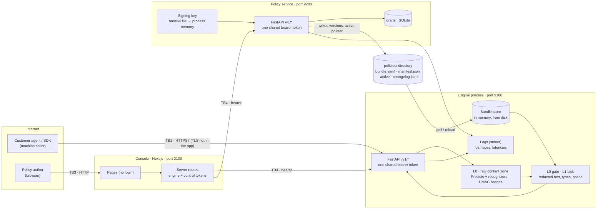

# Threat model: UMAI Cloud (SaaS) and self-hosted

**Status:** first version, 2026-10-17, built from the code as it is (not from the design
documents). Method: data-flow diagram, trust boundaries, STRIDE per element, attack trees for
the two scenarios that end an enterprise contract. Re-run this when a boundary moves (new
store, new provider, new region, SSO).

Companion documents: [gap analysis](gap-analysis.md) (standards × code),
[launch plan](launch-plan.md) (stages and readiness reviews), [verification plan](verification-plan.md)
(what proves each control), and the ADRs 0023–0030.

## 1. What the system is, as built



Trust boundaries:

| TB | Between | What crosses it | State today |
|---|---|---|---|
| TB1 | Internet ↔ engine API | Raw prompt / answer / tool content, tenant id, bundle ref; decision back | One shared static token for every caller (`api/routes.py: require_api_token`); `tenant_id` is a body field. No TLS in the process (expected at an ingress that does not exist yet). No request-size limit, no rate limit |
| TB2 | L0 ↔ everything else | Only redacted text, entity types, spans, scores, HMAC hashes may leave L0 (ADR-0005) | Holds in logs and responses (leak suite, readiness test C1). Does **not** hold for FastAPI 422 bodies, which echo the offending input (readiness GAP-L1) |
| TB3 | Browser ↔ console server | Page requests, playground text, draft edits | **No authentication.** Anyone who reaches the console edits, publishes and activates policies |
| TB4 | Console server ↔ engine, policy service | Relayed calls with the two service tokens | Tokens are server-side env vars (never sent to the browser); nothing says which human acted |
| TB5 | Policy service ↔ bundle source | New versions, active pointer, change log | Same filesystem the engine reads; the service is the only writer. Entries have no actor |
| TB6 | Engine ↔ L1b / L2 providers | Redacted text and facts (future) | Not built; constraints in ADR-0019 §5 |
| TB7 | Gateway ↔ upstream LLM provider (ADR-0034, planned) | Raw content the guardrail allowed (masked where it decided so), the caller's provider key, answers and streams back | Not built. Upstream URLs from a deployment allow-list (SSRF); provider keys passed through, never stored or logged; raw content in memory for one call (ADR-0035) |

## 2. Assets and their classification

| Id | Asset | Class | Where it lives today | Why it matters |
|---|---|---|---|---|
| A1 | Raw content in flight (prompts, answers, tool output) | **Restricted**: customer data, often other people's personal data | Request body → L0 memory only; never stored | The whole product promise. A leak here is the breach that ends the company |
| A2 | Redacted text, entity types, spans, hashes | Confidential | Response; future decision events | Reveals *what kind* of data a customer handles; hashes allow correlation inside one tenant only (HMAC per tenant) |
| A3 | Policy bundles (per customer) | Confidential | `policies/`, engine memory, drafts | Encodes what a customer considers sensitive and who is exempt (`exceptions`): competitive and compliance information |
| A4 | Tenant HMAC keys | Secret | `UMAI_DE_TENANT_HMAC_KEYS` env JSON | With the key, ~10⁹ TCKNs are brute-forceable from hashes (`l0/hashing.py` docstring) |
| A5 | Bundle signing key (Ed25519) | Secret, integrity root | Base64 file read at start, kept in process memory | Whoever holds it publishes policy that every engine trusts |
| A6 | API tokens (engine, policy service, console relay) | Secret | Env vars, `.env` files | Today one token = every tenant, every operation |
| A7 | Decision events, audit trail | Confidential, integrity | Not stored yet (`review_queued=False`); change log without actor | Needed for customer dashboards, SIEM, incident forensics, SOC 2 |
| A8 | Drafts | Confidential | SQLite, unencrypted file | Same sensitivity as A3, before review |
| A9 | Entitlements / licences | Integrity | Not built (ADR-0019) | Tampering = free service or wrong region |
| A10 | Availability of the decision path | — | Single process, no ingress | The guardrail *is* the control: when it is down, customers' AI either stops (fail closed) or runs unprotected (fail open, if they chose it) |
| A11 | Provider credentials passed through the gateway | Secret (the customer's) | Not built (ADR-0034 §5): request header → upstream only | A leak spends the customer's provider budget and exposes their provider account |
| A12 | Gateway routes (upstream, model, guardrail binding) | Confidential, integrity | Not built: tenant store (ADR-0034 §6) | A tampered route sends content to another upstream or binds a weaker guardrail |

## 3. Adversaries

| Actor | Access | Goal | Realistic? |
|---|---|---|---|
| Unauthenticated internet | TB1, TB3 | Read other customers' data, take the service down, publish policy through the open console | Yes, the moment a public hostname exists |
| Another tenant | Valid credential of tenant X | Read Y's bundles, decisions, hashes; evaluate as Y; exhaust Y's quota | Yes: today the shared token makes every tenant "another tenant" |
| Holder of a stolen customer key | Valid credential | Use the service on the customer's bill; read the customer's bundles | Yes (leaked `.env`, CI logs, laptop) |
| Malicious or careless console user | Logged-in author (future) | Switch policies off, publish without review, exfiltrate bundles | Yes; today needs no login at all |
| UMAI operator / insider | Shell on hosts, DB access | Read content, keys, bundles | Must be assumed by every enterprise reviewer |
| Supply chain | Dependencies, container base image, GitHub Actions | Code execution in the engine | Yes; no dependency audit or SBOM in CI today |
| Hostile content | Request body | ReDoS the detector, oversize bodies, confuse recognizers (digit evasion) | Yes; regex timeout exists (`REGEX_TIMEOUT_SECONDS`, default 1 s), body size does not |
| Cloud provider / foreign jurisdiction | Region infrastructure | Compelled access | Drives EU/US residency (ADR-0018) and KVKK questions (Q21) |

## 4. STRIDE per element

S spoofing · T tampering · R repudiation · I information disclosure · D denial of service ·
E elevation of privilege. "Today" is what the code does; "Control" is the ADR or gap that answers it.

| Element | Threat | Today | Control |
|---|---|---|---|
| Engine API (TB1) | **S** any token holder claims any `tenant_id` | Accepted | ADR-0023: tenant from credential; 403 on mismatch (GAP-T1) |
| | **S** stolen token has no expiry, no scope, no revocation short of rotating everyone | Accepted | ADR-0023: per-tenant keys, hashed at rest, scoped, revocable, last-used |
| | **I** `GET /v1/bundles` lists every customer's bundle ids, names, hashes | Accepted | ADR-0025: tenant-owned bundles; store resolves `(tenant, id)` only |
| | **I** 422 body echoes raw content | Accepted | GAP-L1: custom validation handler, `loc` and `type` only |
| | **D** unbounded body, unbounded scan length | Accepted | ADR-0019 §4: 413 above limit; ingress body cap and per-key rate limit (ADR-0023) |
| | **D** `POST /v1/bundles/reload` by any caller | Accepted | Scope `bundles:reload` for the control plane only (ADR-0023) |
| | **R** no decision event stored; logs have request id only | Accepted | ADR-0030: decision events and audit events per tenant |
| L0 (TB2) | **I** raw content in logs/traces/metrics | Prevented (leak suite, C1) | Keep: CI leak test extended to traces and metrics when they exist |
| | **I** hash brute force if a tenant key leaks | Keys in env JSON | ADR-0027/0031: per-tenant keys wrapped by Key Vault Premium, rotatable |
| | **D** ReDoS | Regex timeout 1 s per pattern | Keep; add a latency SLO alert |
| Bundle store (TB5) | **T** unsigned or re-signed bundle | Signature required outside development | ADR-0027/0031: signing key in Key Vault Premium (ECDSA P-256 in cloud, Ed25519 self-hosted); public-key registry, not env |
| | **T** tampered `active` pointer on disk | Anyone with filesystem access | ADR-0025: bundles in Postgres per tenant; SaaS engines pull signed artifacts (`http_pull`), no shared disk |
| Policy service | **S** shared token, no human identity | Accepted | ADR-0024 (humans via OIDC) + ADR-0023 (service credential names the acting user) |
| | **R** change log has no actor | Accepted (GAP-A1) | ADR-0030 audit event with `actor` |
| | **E** publish without review or approval | Review step exists in the console only | ADR-0029: roles editor / approver; four-eyes enforced server-side for production |
| | **I** signing key in process memory for the process lifetime; `keygen` prints it to stdout | Accepted | ADR-0027 |
| | **T** drafts in a plain SQLite file | Accepted | ADR-0025: Postgres, encrypted at rest, per-tenant key |
| Console (TB3/TB4) | **S/E** no login: full admin for anyone on the network | Accepted | ADR-0024: OIDC login behind every page; ADR-0029 roles |
| | **I** service tokens readable by whoever runs the Next.js host | Env vars | Key Vault secrets through Workload ID; per-deployment rotation |
| Ingress (TB1) | **I** TLS terminated outside the region by a global edge (Azure Front Door and CDN are excluded from the EU Data Boundary) | Not deployed | ADR-0026 §9 / ADR-0031 §5: regional Application Gateway WAF_v2 only on content hostnames |
| | **T** CSRF on relay routes once cookies exist | Not applicable yet | SameSite cookies + origin check when sessions arrive (ADR-0024) |
| Storage (future) | **I** cross-tenant read through a missing `WHERE tenant_id` | Not applicable yet (no store) | ADR-0025: Postgres RLS enforced by the database, tested from the schema |
| Telemetry | **I** content in error messages / stack traces | Only ids logged; exceptions mapped to kinds | Keep; structured JSON logs with an allowlist (ADR-0030) |
| Supply chain | **T** compromised dependency or action | Pinned ranges, no audit | pip-audit, Dependabot, SBOM, image signing (launch plan stage 0) |
| Gateway (TB7, planned) | **I** SSRF: a route pointing at internal addresses | Not built | Upstream allow-list in settings; HTTPS only; private ranges refused unless a self-hosted operator lists a host (gateway-api 0.1) |
| | **D/E** a stolen UMAI key spends the customer's provider budget; long streams exhaust connections | Not built | Per-key rate limits and quotas at admission (ADR-0023, ADR-0028); route timeouts; abuse signals per key |
| | **I** raw content or provider keys in logs, errors or events | Not built | ADR-0035; leak suite over gateway outputs before the first customer |

## 5. Attack trees

### 5.1 Cross-tenant data exposure (tenant X reads tenant Y)

```text
GOAL: X obtains Y's content, bundles, hashes or decisions
├── 1. Act as Y at the API                      [open today]
│   ├── 1a. Send body tenant_id = Y with any valid token      ← GAP-T1
│   └── 1b. Guess Y's bundle id; GET /v1/bundles lists them   ← ADR-0025
├── 2. Read Y's rows from a shared store           [not applicable until a store exists]
│   ├── 2a. Query path without tenant filter                   ← RLS, not app code (ADR-0025)
│   ├── 2b. DB role with BYPASSRLS / table owner without FORCE ← ADR-0025 roles
│   └── 2c. Backup or export without tenant scoping            ← ADR-0025 per-tenant keys
├── 3. Correlate Y's hashes                        [needs Y's HMAC key]
│   └── 3a. Shared or leaked key                               ← per-tenant keys hold today; custody ADR-0027
├── 4. Read Y's policies through the console       [open today]
│   └── 4a. No login; one console = every tenant               ← ADR-0024, ADR-0029
└── 5. Operator access                              [assume]
    └── 5a. Shell on the engine host sees requests in memory   ← no content at rest; KMS; access logging; SOC 2 CC6
```

### 5.2 Stolen customer API key

```text
GOAL: attacker with Y's leaked key causes damage
├── 1. Use the service on Y's bill                 [open today: no quota, no rate limit]
│   └── ADR-0019 §4 quota, ADR-0023 per-key rate limit, usage anomaly alert (ADR-0028)
├── 2. Read Y's bundles                            ← scope `bundles:read` separate from `evaluate`
├── 3. Pivot to another tenant                     ← closed by 5.1 controls
├── 4. Persist                                     [open today: no revocation, no expiry]
│   └── ADR-0023: revoke in console, last-used timestamp, optional expiry, rotation without downtime
└── 5. Hide                                         [open today: no audit events]
    └── ADR-0030: key usage in audit/decision events, exportable to the customer's SIEM
```

## 6. Ranked risks

Likelihood and impact on a 1–3 scale for a public SaaS with more than one tenant.

| # | Risk | L | I | Closes with |
|---|---|---|---|---|
| R1 | Console reachable without login → anyone changes live policy | 3 | 3 | ADR-0024 (stage 0 blocker) |
| R2 | Shared token: any customer acts as any tenant | 3 | 3 | ADR-0023 (stage 0 blocker) |
| R3 | No per-tenant store boundary when events/drafts land in a shared DB | 3 | 3 | ADR-0025 before the first store |
| R4 | 422 echoes raw content to the caller and any proxy/APM in between | 2 | 2 | GAP-L1 (small fix, stage 0) |
| R5 | Unbounded request body / scan → memory and CPU exhaustion | 2 | 2 | 413 + ingress cap (stage 0) |
| R6 | Signing key or HMAC keys leak from env / disk | 2 | 3 | ADR-0027 |
| R7 | No audit trail → cannot answer "who switched this policy off" | 3 | 2 | ADR-0030 (stage 0 for config changes) |
| R8 | Dependency compromise, unsigned images | 2 | 3 | Supply-chain controls (stage 0) |
| R9 | Content processed outside the tenant's region by a provider | 1 (no providers yet) | 3 | ADR-0019 §5, ADR-0026 |
| R10 | Over-quota or licence lapse turns into a security outage or silent allow | 2 | 2 | ADR-0019 §4, Q24 |

## 7. Assumptions and out of scope

- TLS is terminated at a regional Application Gateway WAF_v2 (UMAI Cloud, ADR-0031 §5) or the
  customer's proxy (self-hosted); the processes do not serve TLS themselves. This is an
  assumption until the deployment exists.
- Self-hosted installs are operated by the customer; UMAI's controls cover the release
  artifact and its defaults (secure by default, documented hardening), not the customer's hosts.
- L1b / L2 providers are out of this version (not built); their boundary (TB6) is listed so that
  the provider registry carries region and data-handling attributes from the start.
- Physical security, HR controls and vendor management are company controls (SOC 2 CC1–CC5,
  CC9) and appear in the launch plan as evidence items, not here.
